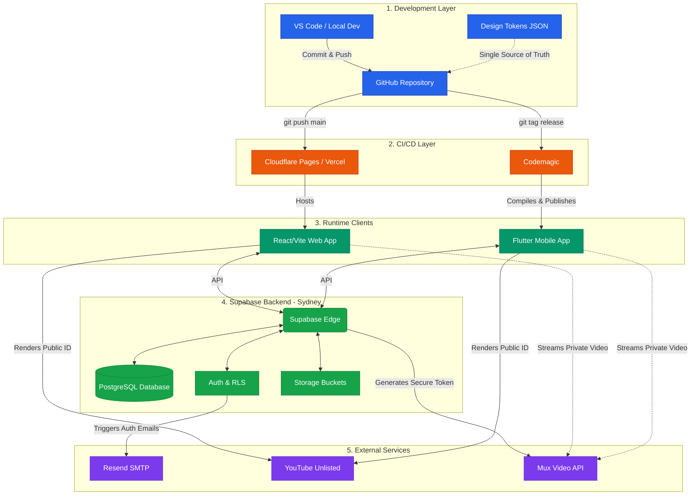

Here is the final, consolidated architecture blueprint for AJ Classes. This diagram visualizes exactly how your web app, mobile app, and backend services connect, while maintaining the "no extra dashboards" rule for your daily development workflow.

This architecture optimizes for solo developer velocity by automating all infrastructure, code signing, and scaling operations.

### Architecture Breakdown & Workflow

This diagram separates the development cycle from the production runtime environments.

**1. The Solo Development Cycle (Top Layer)**
This is where you live day-to-day.

* **Workflow:** You write code locally (VS Code) and sync to **GitHub**. Your single source of truth for the entire visual design (`Design Tokens (JSON)`) is stored here and transpiled during build time for both web and mobile clients.
* **Trigger:** The only action you take is a single `git push` or `git tag`.

**2. The Automated CI/CD Pipelines (Build Layer)**
The moment you push code, specialized platforms take over, ensuring you don't have to manage servers or build hardware.

* **Web Deployment (Vercel):** Every push to `main` triggers Vercel. It fetches the code, compiles the React/Vite app using edge optimization, and updates the public website in seconds.
* **Mobile Deployment (Codemagic):** A push with a new version tag (e.g., `v1.1`) triggers Codemagic. It provisions specialized hardware (including macOS for iOS builds), fetches your code, performs automatic code signing using stored API keys, and pushes the new binaries directly to the **App Store Connect** and **Google Play Console** portals.

**3. The Production Ecosystem (Runtime Layer)**
This is what your students and tutors interact with.

* **The Hub (Supabase Sydney):** Both the React Web App and the Flutter Mobile App connect primarily to Supabase in Sydney via optimized APIs. The client identity is established via **Auth (GoTrue)**. The database enforces **Row Level Security (RLS)**, ensuring a student can only access the `assignments` table for the `classes` they are enrolled in, while tutors have broader access.
* **Secure Video (Mux):** If the database indicates a private tutoring video (gated content), the **Supabase Edge Function** issues a short-lived, signed token. This token is passed to the client (Web or Flutter), which uses it to stream the private video securely from Mux.
* **Testimonial Video (YouTube Unlisted):** If the content is public marketing ( testimonials), the clients simply pull the YouTube ID from the database and render it in a public player component.
* **Email Communication (Resend):** Any auth event (password reset, sign-up confirmation) is handled via **Resend**, ensuring high deliverability without you managing email servers.

This architecture is bulletproof, standard, and highly resilient for a solo developer. By consolidating all stateful data and secure logic inside Supabase (Sydney) and offloading specialized marketing (YouTube), private video (Mux), and mobile builds (Codemagic), you get all the benefits of best-in-class platforms without the overhead of daily maintenance.

## Diagram

