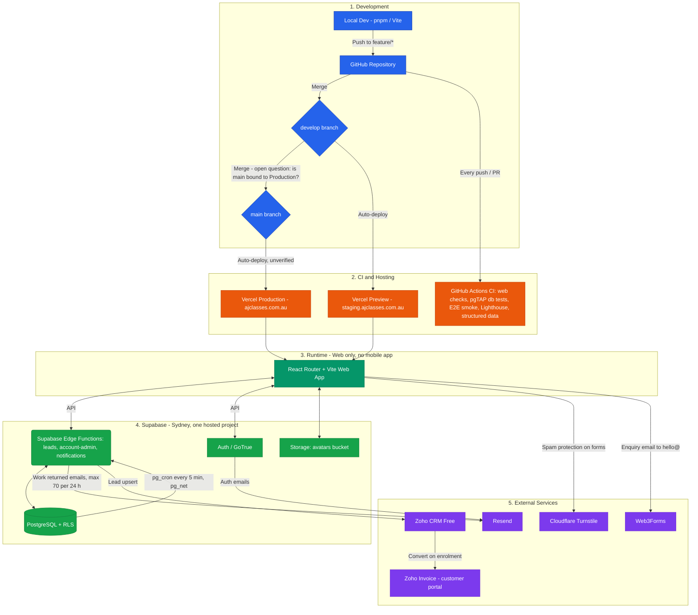

Here is the architecture blueprint for AJ Classes, matching what is actually built and deployed
today (23 Oct 2026). There is **no mobile app**: no Flutter, no Codemagic, no App Store / Google
Play builds, and **no Mux**. None of that was ever built — this doc used to describe a planned
system that was replaced before any of it was implemented. If a future release adds a mobile app
or private video streaming, update this doc rather than treating the old plan as already live.

### Architecture Breakdown & Workflow

**1. Development (solo, GitHub-based)**

You write code locally (Node 24, pnpm workspace: `apps/web` is a React Router v8 + Vite +
TypeScript app) and push to GitHub. Branches: `feature/*` → `develop` → `main`.

* `develop` is the staging branch. Vercel's Preview environment auto-deploys every push to
  `develop` (and other non-`main` branches) to `staging.ajclasses.com.au`.
* `main` is intended to be production (`ajclasses.com.au`), deployed by Vercel's Production
  environment.
* **Open question, not yet verified:** whether Vercel's Production environment is actually bound
  to `main`. A discrepancy was observed where production content matched `develop` even though
  `main` had not been merged recently. Until this is checked in the Vercel dashboard, treat the
  `main`-is-production assumption as unconfirmed rather than fact.

**2. CI (GitHub Actions, `.github/workflows/ci.yml`)**

Runs on every push to `main`/`develop` and every pull request:
* `web` job: `pnpm format:check`, `lint`, `typecheck`, `test` (Vitest), then a production build
  (`VITE_APP_ENV=production`), mirroring what Vercel builds.
* `database` job: spins up a local Supabase (Docker) with every migration applied, then runs the
  pgTAP test suite (`supabase test db`) against it. The Supabase CLI is pinned (2.120.0).
* `E2E smoke` job (item 6, ADR-0006): a fresh local Supabase, the dev server on 5173 with local
  settings only, and the Playwright suite in `e2e/`. The report and traces are uploaded on
  failure (7 days).
* `Lighthouse` job: a production build with no Supabase config, served by the local mirror with
  the committed headers; mobile Lighthouse with the thresholds in `apps/web/lighthouserc.json`
  (median of 3), a check that no run requested `supabase.co`, the median JS per page, and the
  Playwright CSP sweep. Reports stay on the filesystem and go up as an artifact.
* `Structured data` job: the same no-Supabase build, then a check of the JSON-LD on every
  pre-rendered page.

No job reaches the hosted Supabase project; each gate build is checked for the hosted project
ref first. Local commands for every gate: `docs/testing/ci-gates.md`.

**3. Hosting (Vercel)**

Vercel builds and serves the static, pre-rendered React Router app. Public marketing pages are
pre-rendered at build time; the `/portal` app is client-rendered behind rewrites defined in
`apps/web/vercel.json`. Public pages read live data (news) through plain `fetch` in
`services/*.client.ts`, never `supabase-js` (ADR-0001). (The repo also still contains a leftover
Railway config — `railway.json`, `apps/web/serve.railway.json`, the `start:railway` script —
from an earlier staging host; it is not part of the current deployment and should not be read as
active infrastructure.)

Public pages send an enforcing CSP (ADR-0005). It allows only our own origin plus `connect-src` to
Supabase (`unzjnxctkyahtmrkinyr.supabase.co`), Web3Forms (`api.web3forms.com`) and Kit
(`app.convertkit.com`). Adding any third-party script, image, font, frame or API to a public page
means editing the public CSP in **both** `apps/web/vercel.json` and `apps/web/serve.railway.json`;
`src/hosting-csp.test.ts` fails if they differ. The portal keeps its own CSP on `/portal/*`, and the
two rules never overlap. Locally, `pnpm mirror` serves a gate build with these headers, the local
Supabase origin in place of the hosted one.

**4. Backend (hosted Supabase, Sydney)**

One hosted Supabase project (`unzjnxctkyahtmrkinyr`, Sydney region) serves both staging and
production — there is one database, not two. The web app talks to it via `@supabase/supabase-js`:
* **Auth (GoTrue):** invite-only sign-up, two-step (TOTP) for admins, Resend as the SMTP provider
  for auth emails (password reset, invites).
* **Postgres + RLS:** all portal data (classes, students, assignments, enquiries, etc.) is
  enforced by row-level security — e.g. a student can only read the `assignments` rows for
  classes they're enrolled in; admins and tutors have broader access.
* **Storage:** the `avatars` bucket.
* **Edge Functions:** `leads` (public `submit`, admin `resync` — see below), `account-admin`, and
  `notifications` (sends the "work returned" emails; called only by `pg_cron`, see §7).
* **Scheduled jobs:** `pg_cron` runs `email-worker-kick` every 5 minutes (calls `notifications`
  through `pg_net` when emails are waiting) and a daily trim (cron log to 7 days; sent, skipped and failed emails after 90 days).

**5. Lead capture (Zoho CRM Free)**

The public enquiry form posts to Web3Forms (unchanged — this is still what emails `hello@` and
shows the parent "Message sent"). In parallel, when `VITE_LEAD_CAPTURE=on`, the same submission
also hits the Supabase edge function `leads`, which: validates + rate-limits + honeypot-checks the
submission, saves it to the `enquiries` table (source of truth even if Zoho is down), and upserts
it into **Zoho CRM Free** as a Lead (matched by email). Admins can see sync status and retry from
the portal. Spam protection on this form (and other forms) is **Cloudflare Turnstile**, not a
CAPTCHA service bundled with any video/mobile vendor.

**6. Billing (Zoho Invoice)**

Enrolled families are invoiced in **Zoho Invoice**, connected to Zoho CRM where possible. Parents
see a "Fees and invoices" card on their portal home, linking to the Zoho Invoice customer portal.
Payments are PayID / bank transfer today — no Stripe integration exists yet.

**7. Transactional email (Resend)**

All auth-related email (invites, password resets, confirmations) is sent via **Resend**, configured
against the `ajclasses.com.au` domain.

App email (ADR-0004): the **"work returned"** email to students and parents. A trigger queues it in
`email_outbox` when staff return work; the `notifications` edge function sends it through Resend's
HTTP API (Mailpit locally). The app sends at most **70 in any rolling 24 hours**, leaving at least
30 of Resend Free's 100 a day for sign-in email. Families turn it off in Account → Notifications;
admins see failed and waiting sends in Admin → Emails.

This is a solo-developer-friendly setup: one hosted Postgres/Auth backend (Supabase), one hosting
platform for the web app (Vercel), and a small set of managed SaaS tools (Zoho CRM/Invoice, Resend,
Cloudflare Turnstile) rather than any custom infrastructure — but it is web-only. There is no
native mobile client and no private video pipeline in production.

## Diagram

