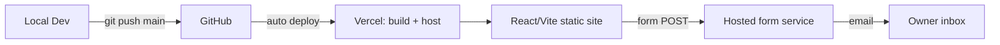

# PRP — Release 1: The Public Face (Static Launch)

> **Status:** Elaborated, ready for build
> **Launch window:** **11–20 October 2026**. The build is ~2 days of dev work, done ahead of launch; purchases (domain etc.) happen closer to launch
> **Source:** [Master PRP](../PRP.md) · **Architecture:** [arch.md](../../architecture/arch.md)
> **Next release:** [Release 1.1 — Calendar, Events, News & Updates](../release-1.1/PRP.md)

---

## 1. Objective

Get AJ Classes on the market **as fast as possible** with a professional static website that:

1. Establishes the brand and explains the offer.
2. Captures enquiries from parents and students.

There is **no backend, database or testimonials** in this release. Everything is a static site on Vercel.

**Release roadmap for the public site:**

| Section | Release | Why there |
|---|---|---|
| Hero, Why AJ Classes, **Our Approach**, About / Our Team, FAQ, Register Interest / Contact | **R1** | Core pitch. The content exists at launch |
| **Follow us** (social links) | **R1** | Trivial to build. Also feeds SEO `sameAs` (F6.4) |
| **Subscribe** (footer email sign-up) | **R1** (basic) | Same form service as Contact. Proper list and unsubscribe arrive in R2 |
| **Calendar** (term dates), **Events**, **News & Updates** | [**R1.1**](../release-1.1/PRP.md) (1–2 weeks after launch) | Dated content that needs regular updates. Still static, no backend |
| **Testimonials** | [**R2**](../release-2/PRP.md) | Comes with Supabase, as planned |

A section with no content is **hidden**, never shown as "coming soon". Empty placeholders make a new business look unfinished.

### 1.1 Success Criteria

| Criterion | Target |
|---|---|
| Live on production domain over HTTPS | Between 11 and 20 October 2026 |
| Contact form enquiries reach the owner's inbox | 100% of valid submissions |
| Lighthouse (mobile): Performance, Accessibility, Best Practices, SEO | ≥ 90 each |
| Looks right on mobile and desktop | No layout breaks from 360px to 1920px |
| Indexed by Google | `site:` search returns the home page within 7 days of launch |
| Branded ranking | **#1 organic result for "AJ Classes" on google.com.au within 4 weeks** |

### 1.2 Target Audience

- **Parents** of students preparing for the selective-entry high school exam (the main decision-makers). Based in Melbourne, with online classes for students Australia-wide.
- **Students** researching tutoring options.

### 1.3 Competitive Benchmark: melbournetutorials.com.au

This is the site we need to beat for **usability and readability**. Reviewed 24 Sep 2026.

| Area | What they do | Our response |
|---|---|---|
| **Look** | Dark navy with a serif display font and orange CTAs. Polished, premium feel | Match the polish, but use our **own** brand (no copying of palette or layout). A clean, light, high-contrast design reads better for long sections |
| **Page length** | Homepage is ~14,000px tall with 13 sections. It feels endless | **About 8 sections, ~5–6 screen heights.** Each section answers one question. Details go on later pages, not the homepage |
| **Navigation** | ~147 links on the homepage, a mega-menu with 30+ items, plus an announcement bar, a campus bar and two nav rows | **At most 6 nav items + 1 CTA**. One header row. No mega-menu in R1 |
| **Social proof** | Big honour board (~150 student names), **shown twice** on the homepage | Show proof **once**, in a compact form (e.g. 3 headline stats). Testimonials come in R2 |
| **Calls to action** | "Expression of Interest" appears many times, with "Enrol", "Register interest" and "Check an essay" competing | **One primary CTA label everywhere** (e.g. "Register Interest"), plus one secondary ("Ask a Question") |
| **Readability** | ~18px body, but long unbroken paragraphs | 18px body, max ~70 characters per line, short paragraphs (≤ 3 sentences), scannable cards and bullet points |
| **Content they have that we'll add later** | Events, news, term dates, testimonials, honour board, program pages, fees, FAQs | Events, News, Calendar → R1.1. Testimonials → R2. Honour board / results once we have outcomes (future) |
| **SEO** | Title is just "Melbourne Tutorials", with **no meta description**. Has basic JSON-LD | Descriptive title, meta description, richer JSON-LD (F6). A clear gap we can win on |

**Rule of thumb:** a parent on a phone should understand **what AJ Classes is, why it's different and how to register interest within 30 seconds**, without opening a menu.

---

## 2. Scope

### 2.1 In Scope

| # | Feature | Summary |
|---|---|---|
| F1 | Theme via CSS variables | Brand colours and fonts in one file, so the brand can be swapped later without touching components |
| F2 | Landing page (single page) | Header, Hero, Why AJ Classes, Our Approach, About / Our Team, FAQ, Register Interest / Contact, Footer (Subscribe + Follow us) |
| F3 | Register Interest / Contact form + Subscribe | Both sent to the owner's email through a hosted form service. No backend code |
| F4 | Privacy page | Short privacy notice, needed because the form collects names and emails |
| F5 | Hosting & domain | GitHub → Vercel auto-deploy, custom domain, HTTPS |
| F6 | SEO: rank #1 for "AJ Classes" in Australia | Pre-rendered HTML, full head tags, JSON-LD structured data, technical SEO, Search Console, Google Business Profile |
| F7 | Analytics | Vercel Web Analytics + Search Console |
| F8 | Constants: no magic strings | All text, config, errors, SEO, routes and event names come from typed files in `src/constants/`; lint-enforced |

### 2.2 Moved to Later Releases

**Release 1.1** (static, 1–2 weeks after launch):
- **Calendar**: term dates
- **Events**: upcoming events (e.g. info sessions, mock exams, awards night)
- **News & Updates**: short dated announcements

**Release 2:**
- Supabase project (Sydney), database and Edge Functions
- **Testimonials** (YouTube video and written reviews)
- Contact enquiries stored in a database, with emails sent via Resend
- Proper subscriber list with an unsubscribe flow
- Design tokens as JSON with a Style Dictionary build (needed later for Flutter)
- Additional content pages for SEO (e.g. separate About and Testimonials pages), Lighthouse CI, Playwright tests, Sentry. *(Pre-rendering is **in** R1 for SEO; see F6.1.)*

### 2.3 Out of Scope

Login, dashboards, payments, booking, mobile app, marketing emails.

---

## 3. Architecture (Release 1)



| Concern | Choice | Notes |
|---|---|---|
| Framework | **React + Vite + TypeScript** | Same stack as the target architecture, so later releases build on this code |
| Hosting | **Vercel** (free Hobby tier) | Every push to `main` deploys. PRs get preview URLs automatically |
| Form handling | **Web3Forms** (default) or **Formspree** | Form posts directly from the browser. No server code or secrets |
| Analytics | **Vercel Web Analytics** | Cookieless, so no cookie banner is needed |
| Styling | Plain CSS + CSS custom properties (or CSS Modules) | No UI library, to keep it light and fast |

**Why a hosted form service:** it gets email delivery working in minutes, with built-in spam filtering, and no Supabase, Resend or DNS email setup. In Release 2 the form's `action` is switched to the Supabase Edge Function. The form UI stays the same.

> **Note on Web3Forms vs Formspree:** Web3Forms forwards submissions by email and does not store them (better for privacy). Its free tier is 250 submissions a month. Formspree stores submissions in a dashboard, but its free tier is only 50 a month. Either is fine for launch.

### 3.1 Repository Layout

```
aj_classes/
├── apps/web/
│   ├── index.html            # base head tags (per-route tags added at pre-render)
│   ├── public/               # images, og-image.png, favicons, site.webmanifest, robots.txt
│   └── src/
│       ├── styles/theme.css  # ← all brand variables (F1)
│       ├── styles/global.css
│       ├── constants/        # ← ALL text + config (F8): no magic strings anywhere else
│       │   ├── app.constants.ts       # config: site URL, feature flags, form endpoint, limits
│       │   ├── business.constants.ts  # facts: name, email, phone, suburb, service area, social links
│       │   ├── content.constants.ts   # all user-facing copy: tagline, hero, sections, FAQ, footer
│       │   ├── error.constants.ts     # validation, form-error and 404 messages
│       │   ├── seo.constants.ts       # titles, descriptions, OG/Twitter, JSON-LD inputs
│       │   ├── routes.constants.ts    # page paths + section anchor IDs
│       │   ├── analytics.constants.ts # analytics event and property names
│       │   └── index.ts               # re-exports
│       ├── components/       # Button, Section, Header, Footer, ContactForm
│       ├── sections/         # Hero, WhyUs, Approach, About, Faq, Contact (+ R1.1: Calendar, Events, News)
│       └── App.tsx
└── docs/
```

`apps/web` sits in a folder from day one so that `apps/mobile` and `supabase/` can be added later without moving files.

---

## 4. Functional Requirements

### F1 — Theme via CSS Variables

| ID | Requirement |
|---|---|
| F1.1 | All colours, fonts, radii and shadows are defined **once** as CSS custom properties on `:root` in `src/styles/theme.css`. |
| F1.2 | Components use only `var(--…)`, never hard-coded hex values or font names. |
| F1.3 | Brand values come from the **final logo** (see below). Any later brand change only touches `theme.css`. |
| F1.4 | **Gold (`--color-secondary`) is never used for text on white or light backgrounds**, because its contrast is only ~1.6:1 and fails WCAG. It is for accents, icons, and highlights or text on navy (`--color-bg-inverse`). Text and buttons on white use blue or navy. |

**Minimum variable set:**

```css
:root {
  /* Brand */
  --color-primary: #2563eb;        /* logo blue */
  --color-primary-hover: #1d4ed8;
  --color-secondary: #f9c62b;      /* logo gold: accents only (F1.4) */
  --color-on-primary: #ffffff;

  /* Surfaces & text */
  --color-bg: #ffffff;
  --color-bg-subtle: #f5f9ff;
  --color-bg-inverse: #172554;     /* navy: feature band, footer */
  --color-text: #172033;
  --color-text-muted: #6b7280;
  --color-text-emphasis: #172554;
  --color-text-inverse: #f8fafc;
  --color-border: #e5e7eb;
  --color-focus: #2563eb;
  --color-error: #b91c1c;
  --color-success: #15803d;

  /* Typography */
  --font-heading: "Inter", system-ui, sans-serif;
  --font-body: "Inter", system-ui, sans-serif;

  /* Shape */
  --radius-md: 8px;
  --radius-lg: 16px;
  --shadow-md: 0 4px 12px rgb(0 0 0 / 0.08);
  --container-max: 1120px;
}
```

In Release 2 or 5 these names become the semantic layer of the JSON design tokens, so choosing them now avoids renaming later.

**Acceptance criteria**
- [ ] Changing `--color-primary` updates every button, link and accent on the site.
- [ ] A search for `#[0-9a-f]{3,6}` in `src/` outside `theme.css` returns nothing.

---

### F2 — Landing Page (single page, anchored sections)

Each section answers one parent question. Copy for every section is in **[Appendix A](#appendix-a--content-placeholders)**.

| # | Section | Parent's question | Content |
|---|---|---|---|
| 1 | **Header** | Where do I go? | Logo; links **Approach · About · FAQ · Contact**; primary button **"Register Interest"**; social icons (small, desktop only). Sticky, one row. Hamburger menu on mobile |
| 2 | **Hero** | What is this? | **Announcement pill** above the headline (F2.11), then headline, one supporting sentence, primary CTA **"Register Interest"**, secondary CTA **"Ask a Question"**, hero image. A strip of 3 short proof points below it (e.g. "Selective-entry specialists · Qualified tutors · Small groups") |
| 3 | **Why AJ Classes** | Why you, not someone else? | Value cards: 4–6 word title, 1–2 sentence description. **6 cards in a 3 × 2 grid** since 6 Oct 2026, adding "Aligned to the Victorian Curriculum" and "A plan for every student" (A.12) |
| 3a | **Our 2026 results** *(added 30 Sep 2026)* | Do you get results? | 3 stat cards: 7 selective high school offers (Year 9), 5 John Monash Science School offers, 3 private school scholarships, plus a one-line note on NAPLAN/ICAS. Aggregate numbers only, **no student names** |
| 3b | **Programmes** *(added 30 Sep 2026)* | What exactly do you teach? | Card grid: each programme with its year levels (Selective exam prep, interviews, SEAL and scholarships, NAPLAN, ICAS, school tutoring, VCE counselling, UCAT/GAMSAT with a "New" badge). Each card lists **2–3 short ✓ points**, not a paragraph (6 Oct 2026, A.12). Also a nav link |
| 4 | **Our Approach** | How do you teach? | Teaching philosophy in 2–3 short paragraphs, plus a 3–4 step visual (e.g. Assess → Plan → Practise → Review) |
| 5 | **About Us / Our Team** | Who will teach my child? | Short story of AJ Classes, then a **team description (no individual names or photos in R1)**: "a team of skilled teachers and professors", subjects covered, and a **"Working With Children Check held"** trust badge. Individual tutor profiles come in a later release |
| 5a | **CTA banner** *(added 6 Oct 2026)* | Ready to start? | Full-width navy band: "Ready to see what your child can achieve?", one line about the no-obligation initial assessment, and the same **"Register Interest"** button (F2.2). Sits between About and FAQ (A.12) |
| 6 | **FAQ** | What else do I need to know? | 5–8 questions in an accordion (also used for SEO, F6.2.6) |
| 7 | **Register Interest / Contact** | How do I start? | Form (F3) with a **Contact details card** beside it (stacked below on phones): email, phone, location, class hours, response time. Phone and class hours are hidden until confirmed (`BUSINESS.phone`, `BUSINESS.classHours`) (A.12) |
| 8 | **Footer** | — | **Subscribe** (email-only sign-up, F3.6); **Follow us** (social icons + handles); quick links; email; Privacy; © line |

**Readability & usability rules (the ways we beat the competitor)**

| ID | Rule |
|---|---|
| F2.1 | All text lives in `src/constants/content.constants.ts` (F8), so the copy can be edited without touching components. **Any section with empty content is not rendered** (no "coming soon"). |
| F2.2 | **One primary CTA label everywhere**: "Register Interest". It scrolls to the form with enquiry type "Register interest for enrolment" preselected. The "Ask a Question" CTA preselects "General question". |
| F2.3 | **Typography:** body 18px (min 16px on mobile), line-height 1.6, max line length ~70ch, headings clearly larger with a consistent scale. Paragraphs ≤ 3 sentences. |
| F2.4 | **Layout:** generous white space between sections (≥ 80px desktop / 56px mobile). Alternating background bands (`--color-bg` / `--color-bg-subtle`) so sections are easy to tell apart. |
| F2.5 | **Navigation:** at most 6 links + 1 CTA. Active section highlighted while scrolling. Smooth scrolling (turned off under `prefers-reduced-motion`). |
| F2.6 | **Mobile:** a sticky bottom bar with **"Register Interest"** appears once the hero is scrolled past (below 900px, where the header button folds into the menu). It hides again once the form comes into view, so it never covers the form or footer. Built 6 Oct 2026 (`MobileCtaBar`). Tap targets ≥ 48px. No horizontal carousels for key content. |
| F2.7 | **Page length:** about 5–6 screen heights on desktop. If a section grows too long, it moves to its own page in a later release instead of lengthening the homepage. |
| F2.8 | Images are compressed WebP with explicit `width` and `height` (no layout shift). Images below the fold are lazy-loaded. |
| F2.9 | Accessibility: one `h1`, logical heading order, alt text on every image, visible focus styles, a skip link, contrast ≥ 4.5:1 for body text, and the FAQ accordion uses `<details>`/`<summary>` or proper ARIA. |
| F2.10 | **Follow us:** social links come from one `SOCIAL_LINKS` list in `business.constants.ts` (platform, handle, URL). Icons have accessible labels (e.g. "AJ Classes on Instagram") and open in a new tab with `rel="noopener"`. A platform with no URL is not shown. The same list feeds JSON-LD `sameAs` (F6.4). |
| F2.11 | **Announcement pill (hero):** a rounded, clickable pill **inside the hero, above the headline**, e.g. `🔥 2027 classes start in October: Register interest →`. It is **not** a separate top bar (the competitor stacks three bars above its nav, which is what we're avoiding). Styling: brand gold background (`--color-secondary`) with navy text (`--color-text-emphasis`), which is high contrast and meets F1.4. Clicking it scrolls to the form with "Register interest for enrolment" preselected. The emoji is `aria-hidden`, and the whole pill is one link with an accessible name. Text lives in `content.constants.ts` (`ANNOUNCEMENT.text`, `ANNOUNCEMENT.cta`); the on/off switch is `APP_CONFIG.features.announcement` in `app.constants.ts`. Keeps the single CTA wording ("Register interest"), not "Join the waitlist" (F2.2). |
| F2.12 | **Hero flyer slideshow** (added 1 Oct 2026, owner request; inspired by printed tutoring flyers). Four flyer-style slides beside the headline, built in HTML/SVG (not images), so text is sharp, searchable and editable in `HERO_SLIDES` (`content.constants.ts`). Each slide: eyebrow label, headline, simple book/chart/target artwork, three points and a CTA. **The whole slide links to the contact form.** Tones: blue, navy, gold (all WCAG AA). **Exception to F2.6** ("no carousels for key content"): the slides only *repeat* content shown elsewhere on the page. Accessibility (WCAG 2.2.2): auto-advances every 6 s (`APP_CONFIG.heroSlideshow`), pauses on hover/focus, has a pause/play button, prev/next and dot controls (44 px targets), hidden slides are `inert`, and there is **no auto-advance when the visitor prefers reduced motion** |

**Acceptance criteria**
- [ ] Renders cleanly at 360, 768, 1280 and 1920px with no horizontal scroll.
- [ ] Every nav link and CTA scrolls to the right section. The mobile menu closes after a link is tapped.
- [ ] The whole page can be used with the keyboard alone.
- [ ] **30-second test:** 3 parents (or friends) on a phone can say what AJ Classes offers and find how to register interest within 30 seconds, without help.
- [ ] Side-by-side review against melbournetutorials.com.au on mobile: our page is shorter, has fewer competing CTAs, and passes the same Lighthouse checks with equal or better scores.
- [ ] Removing a section's content in `content.constants.ts` hides the section and its nav link.

---

### F3 — Register Interest / Contact Form + Subscribe

One main form covers both enquiries and registrations of interest. A second, email-only Subscribe box sits in the footer. Both post to the same form service, so R1 has only one integration.

| Field | Type | Rules |
|---|---|---|
| Name | text | Required, 2–100 chars |
| Email | email | Required, valid format |
| Preferred contact method | radio | **Required:** Phone call / Email. We contact each family the way they choose |
| Phone | tel | **Required if "Phone call" is chosen**, optional otherwise. Australian format (mobile or landline) |
| I am a… | select | Parent / Student / Other |
| Enquiry type | select | **Register interest for enrolment** / General question / Other. Preselected by CTA (F2.2) |
| Student's year level | select | Optional: Year 2 – Year 10 |
| Message | textarea | Required for "General question" and "Other"; optional for "Register interest". Max 2000 chars |
| Updates consent | checkbox | Optional: "Email me about AJ Classes updates and enrolment openings." Needed under the Spam Act 2003 before sending any marketing email later |
| Privacy acknowledgement | text | "By submitting, you agree to our [Privacy Policy](/privacy)." |
| Honeypot | hidden | Built-in spam trap from the form service (`botcheck` / `_gotcha`) |

| ID | Requirement |
|---|---|
| F3.1 | The form submits with `fetch` (no page reload) to the form service endpoint. The form service's **public** access key is a build env var (`VITE_FORM_ACCESS_KEY`). |
| F3.2 | Client-side validation runs before submit, with inline error messages linked to fields (`aria-describedby`). |
| F3.3 | Four states: idle → submitting (button disabled, spinner) → **success** ("Thanks! We'll be in touch within 2 business days") → or **error** ("Something went wrong. Please email us at …" with a `mailto:` link as fallback). |
| F3.4 | The email subject includes the enquiry type so the owner can filter, e.g. `[AJ Classes] Register interest — Priya S.`. |
| F3.5 | The owner's email is configured in the form service dashboard, not in the code. |
| F3.6 | **Subscribe (footer) → Kit newsletter** *(updated 6 Oct 2026; was Web3Forms + tick box)*. Weekly update for parents and guardians, managed in **Kit** (free plan: up to 10,000 subscribers, unlimited sends). The form has **one email field and a Subscribe button**, with consent wording beside the button (no tick box) and **no captcha**: Kit sends a **confirmation link (double opt-in)**, which blocks bots and typos and records consent. Success message: "Almost done! We've sent a confirmation link to {email}…". After confirming, Kit redirects to **`/subscribed`** (thank-you page, noindex, with an "add hello@ to your contacts" tip). The form is **hidden until `VITE_KIT_FORM_ID` is set**. Code: `services/kit.client.ts` posts to Kit's public form endpoint `https://app.convertkit.com/forms/{formId}/subscriptions` (form ID only, no API key). **Owner setup:** create the Kit account (needs `hello@ajclasses.com.au`), add sender name and postal address, turn on double opt-in, set the redirect to `https://ajclasses.com.au/subscribed`, add the sending domain once DNS is ready, then add `VITE_KIT_FORM_ID` in Vercel/Railway. Import any earlier "New subscriber" emails into Kit |
| F3.7 | **Spam protection: hCaptcha** (added 29 Sep 2026; enabled for our access key in the Web3Forms dashboard). The Register Interest form (the footer Subscribe form moved to Kit on 6 Oct 2026, F3.6) show the hCaptcha "I am human" check, using Web3Forms' shared sitekey (`APP_CONFIG.form.captchaSiteKey`). The token is sent as `h-captcha-response`. Submitting without passing the check shows "Please complete the \"I am human\" check." Tokens are single-use, so the widget resets after a failed send. The privacy notice names hCaptcha as a processor. Docs: https://docs.web3forms.com/getting-started/customizations/spam-protection/hcaptcha |

**Acceptance criteria**
- [ ] A test submission from production arrives in the owner's inbox within 1 minute, with all fields, and not in spam.
- [ ] Submitting with required fields empty shows inline errors and sends nothing.
- [ ] If the request fails (simulated offline), the error state and the `mailto:` fallback are shown.

---

### F4 — Privacy Page

| ID | Requirement |
|---|---|
| F4.1 | Route `/privacy` (a lightweight second page, or a modal if routing is not wanted yet). |
| F4.2 | Plain-English notice covering: what is collected (form fields), why (to respond to enquiries and send updates if the user opted in), who handles it (the form service provider, which may be outside Australia, and Vercel Analytics, which is cookieless), how to ask for access or deletion (the business email), and no selling of data. |
| F4.3 | The owner supplies or approves the wording. **Engineering provides the page, not legal advice.** |

---

### F5 — Hosting, Deployment & Domain

| ID | Requirement |
|---|---|
| F5.1 | GitHub repo (private). Vercel project linked to `apps/web` (framework preset: Vite). |
| F5.2 | A push to `main` deploys to production. Branches and PRs get preview URLs, which is the review step. |
| F5.3 | Custom domain added in Vercel. DNS records set at the registrar (apex `A`/`ALIAS` and `www` `CNAME`). One is canonical and the other redirects to it. |
| F5.4 | HTTPS is automatic through Vercel. |
| F5.5 | `vercel.json` sets basic security headers: `Strict-Transport-Security`, `X-Content-Type-Options: nosniff`, `Referrer-Policy: strict-origin-when-cross-origin`, `X-Frame-Options: DENY`. |
| F5.6 | The `npm run build` (typecheck + build) must pass for Vercel to deploy. **No separate CI pipeline in R1.** |

---

### F6 — SEO (goal: #1 on Google Australia for "AJ Classes")

**Goal:** a search for **"AJ Classes"** (and variants such as "AJ Classes Melbourne" or "AJ Classes selective") on google.com.au returns our site as the **#1 organic result**, ideally with a **Google Business Profile / Knowledge Panel** on the right and **sitelinks** underneath.

> **What to expect:** tags alone don't earn a #1 ranking. For a *branded* search, Google needs to (1) find and index the site, (2) be confident that "AJ Classes" is this business, and (3) see that the site is the official source. Section F6 covers all three: technical SEO and tags on the site (F6.1–F6.6) and off-site brand signals (F6.7). Plan on **1–4 weeks** after launch to reach #1 for the brand name. Other businesses called "AJ Classes" (in Australia or overseas) are the main thing that could slow this down; F6.3 and F6.7 are the counter to that.

The domain is **`ajclasses.com.au`** (finalised 27 Sep 2026, confirmed available; to be purchased before launch, ideally by ~3 Oct 2026).

#### F6.1 — Crawlable HTML (pre-rendering)

A plain Vite SPA serves an empty `<div id="root">`. Google can render JavaScript, but it's slower and less reliable, and other crawlers (Bing, social previews, AI search) often can't.

| ID | Requirement |
|---|---|
| F6.1.1 | **Pre-render every route to static HTML at build time** (e.g. `vite-react-ssg`, or `vite-plugin-prerender`), so `/` and `/privacy` ship the full text, headings and JSON-LD in the initial HTML. |
| F6.1.2 | Per-route head tags are managed with `react-helmet-async` (or the SSG's head API) and baked into the pre-rendered HTML. |

**Acceptance:** `curl -s https://ajclasses.com.au | grep "AJ Classes"` shows the `h1`, the body copy and the JSON-LD, not just an empty root div.

#### F6.2 — On-page Content Signals

| ID | Requirement |
|---|---|
| F6.2.1 | **Title** (≤ 60 chars), brand first: `AJ Classes | Selective Entry Exam Tutoring in Melbourne`. |
| F6.2.2 | **`h1`** contains the exact brand name, e.g. "AJ Classes: Selective Entry Exam Coaching for Australian Students" (matches the wireframes). Only one `h1` per page. |
| F6.2.3 | The exact phrase **"AJ Classes"** appears naturally in the first paragraph, the About section, image alt text (`alt="AJ Classes logo"`), and the footer. Use one consistent spelling everywhere (no "AJ-Classes", "AJClasses" or "A.J. Classes" in copy). |
| F6.2.4 | Secondary keywords in `h2`s and body copy: *selective entry exam*, *selective school tutoring*, *online selective exam tutoring Australia*, *Victoria*, *Melbourne*, *Year 8 entry*, official school names: *Melbourne High School*, *The Mac.Robertson Girls' High School*, *Nossal High School*, *Suzanne Cory High School* (Victoria's four selective entry high schools) and *John Monash Science School* (specialist school with its own entry). Always use these official names and spellings (checked 1 Oct 2026). |
| F6.2.5 | Footer shows **NAP** (Name, Address/Service area, Phone/Email) in exactly the same form used in the Google Business Profile and directory listings (F6.7). |
| F6.2.6 | An **FAQ section** on the landing page (5–6 real questions, e.g. "What is the Victorian selective entry exam?", "Which year levels does AJ Classes teach?", "Are classes online or in person?"). This adds relevant text for search and answers what parents ask. |
| F6.2.7 | Descriptive, keyword-relevant image file names (e.g. `aj-classes-selective-exam-tutoring.webp`, not `IMG_1234.webp`). |

#### F6.3 — Complete Head Tag Set

Every one of these goes in the pre-rendered `<head>` of the home page. `/privacy` gets its own title, description and canonical.

```html
<html lang="en-AU">
<head>
  <meta charset="utf-8" />
  <meta name="viewport" content="width=device-width, initial-scale=1" />

  <!-- Core SEO -->
  <title>AJ Classes | Selective Entry Exam Tutoring in Melbourne</title>
  <meta name="description" content="AJ Classes offers expert coaching for the Victorian selective entry high school exam. Small groups, personalised feedback, proven results. Register your interest today." />
  <link rel="canonical" href="https://ajclasses.com.au/" />
  <meta name="robots" content="index, follow, max-image-preview:large, max-snippet:-1, max-video-preview:-1" />
  <meta name="author" content="AJ Classes" />
  <meta name="application-name" content="AJ Classes" />
  <meta name="apple-mobile-web-app-title" content="AJ Classes" />
  <meta name="theme-color" content="#2563eb" />

  <!-- Locale / geo targeting (Australia) -->
  <link rel="alternate" hreflang="en-AU" href="https://ajclasses.com.au/" />
  <link rel="alternate" hreflang="x-default" href="https://ajclasses.com.au/" />
  <meta name="geo.region" content="AU-VIC" />
  <meta name="geo.placename" content="Truganina, Melbourne" />

  <!-- Open Graph (Facebook, WhatsApp, LinkedIn, iMessage) -->
  <meta property="og:type" content="website" />
  <meta property="og:site_name" content="AJ Classes" />
  <meta property="og:locale" content="en_AU" />
  <meta property="og:title" content="AJ Classes | Selective Entry Exam Tutoring in Melbourne" />
  <meta property="og:description" content="Expert coaching for the Victorian selective entry exam. Register your interest today." />
  <meta property="og:url" content="https://ajclasses.com.au/" />
  <meta property="og:image" content="https://ajclasses.com.au/og-image.png" />
  <meta property="og:image:width" content="1200" />
  <meta property="og:image:height" content="630" />
  <meta property="og:image:alt" content="AJ Classes: Selective Entry Exam Tutoring" />

  <!-- Twitter / X -->
  <meta name="twitter:card" content="summary_large_image" />
  <meta name="twitter:title" content="AJ Classes | Selective Entry Exam Tutoring in Melbourne" />
  <meta name="twitter:description" content="Expert coaching for the Victorian selective entry exam." />
  <meta name="twitter:image" content="https://ajclasses.com.au/og-image.png" />
  <!-- <meta name="twitter:site" content="@ajclasses" />  only if an X account exists -->

  <!-- Icons & manifest -->
  <link rel="icon" href="/favicon.ico" sizes="32x32" />
  <link rel="icon" href="/icon.svg" type="image/svg+xml" />
  <link rel="apple-touch-icon" href="/apple-touch-icon.png" /> <!-- 180×180 -->
  <link rel="manifest" href="/site.webmanifest" />             <!-- name, short_name, 192/512 icons -->

  <!-- Search engine ownership verification (values from each console) -->
  <meta name="google-site-verification" content="…" />  <!-- or DNS TXT, preferred -->
  <meta name="msvalidate.01" content="…" />             <!-- Bing Webmaster Tools -->

  <!-- Performance hints -->
  <link rel="preload" as="image" href="/hero.webp" fetchpriority="high" />
  <link rel="preconnect" href="https://fonts.gstatic.com" crossorigin />
</head>
```

| ID | Requirement |
|---|---|
| F6.3.1 | All the tags above are present and filled with real values on production. |
| F6.3.2 | **Favicon matters for branded search:** Google shows it next to the result. Provide a clear square logo mark (at least 48×48, ideally a multiple of 48) as `favicon.ico`, `icon.svg` and 192/512 PNGs. |
| F6.3.3 | `og-image.png` (1200×630) with the logo, brand name and tagline. |
| F6.3.4 | `meta keywords` is **not** added. Google ignores it and it only exposes keyword strategy to competitors. |

#### F6.4 — Structured Data (JSON-LD)

This is the strongest on-site signal that tells Google "AJ Classes" is this organisation. It helps Google build a Knowledge Panel and show the logo and site name.

One `<script type="application/ld+json">` with an `@graph` in the home page `<head>`:

```json
{
  "@context": "https://schema.org",
  "@graph": [
    {
      "@type": ["EducationalOrganization", "LocalBusiness"],
      "@id": "https://ajclasses.com.au/#organization",
      "name": "AJ Classes",
      "alternateName": ["AJ Classes Truganina", "AJ Classes Melbourne", "AJClasses"],
      "url": "https://ajclasses.com.au/",
      "logo": {
        "@type": "ImageObject",
        "url": "https://ajclasses.com.au/logo-512.png",
        "width": 512, "height": 512
      },
      "image": "https://ajclasses.com.au/og-image.png",
      "description": "Expert coaching for the Victorian selective entry high school exam.",
      "email": "hello@ajclasses.com.au",
      "telephone": "+61-…",            // TBC: omit this property until the number is confirmed
      "address": {
        "@type": "PostalAddress",
        "addressLocality": "Truganina",
        "postalCode": "3029",
        "addressRegion": "VIC",
        "addressCountry": "AU"
      },
      "areaServed": [
        { "@type": "City", "name": "Melbourne" },
        { "@type": "State", "name": "Victoria" },
        { "@type": "Country", "name": "Australia" }
      ],
      "knowsAbout": ["Victorian Selective Entry High School Exam", "Selective school exam preparation", "Selective school interview preparation", "NAPLAN", "ICAS", "Mathematics", "Science", "English"],
      "sameAs": [
        "https://www.facebook.com/…",
        "https://www.instagram.com/…",
        "https://www.linkedin.com/company/…",
        "https://www.youtube.com/@…",
        "https://maps.google.com/?cid=…"
      ]
    },
    {
      "@type": "WebSite",
      "@id": "https://ajclasses.com.au/#website",
      "url": "https://ajclasses.com.au/",
      "name": "AJ Classes",
      "alternateName": "AJClasses",
      "inLanguage": "en-AU",
      "publisher": { "@id": "https://ajclasses.com.au/#organization" }
    },
    {
      "@type": "WebPage",
      "@id": "https://ajclasses.com.au/#webpage",
      "url": "https://ajclasses.com.au/",
      "name": "AJ Classes | Selective Entry Exam Tutoring in Melbourne",
      "isPartOf": { "@id": "https://ajclasses.com.au/#website" },
      "about": { "@id": "https://ajclasses.com.au/#organization" },
      "inLanguage": "en-AU"
    },
    {
      "@type": "FAQPage",
      "mainEntity": [
        { "@type": "Question", "name": "What is the Victorian selective entry exam?",
          "acceptedAnswer": { "@type": "Answer", "text": "…" } }
      ]
    }
  ]
}
```

| ID | Requirement |
|---|---|
| F6.4.1 | JSON-LD is generated from `business.constants.ts`, `seo.constants.ts` and the FAQ in `content.constants.ts`, so the NAP, FAQ and social links have a single source and always match the visible page. |
| F6.4.2 | **Structured data may only contain information that is visible on the page and true.** Leave out the street address or phone number if the business doesn't want them public, and drop that property rather than inventing one. |
| F6.4.3 | No `Review` or `AggregateRating` markup in R1: there are no testimonials yet, and self-serving review markup isn't eligible for rich results anyway. |
| F6.4.4 | `sameAs` lists **only profiles that exist**. Add entries as profiles are created (F6.7). |
| F6.4.5 | Passes the [Rich Results Test](https://search.google.com/test/rich-results) and the [Schema Markup Validator](https://validator.schema.org/) with no errors. |

> **FAQ note:** Google now shows FAQ rich results mostly for government and health sites, so we shouldn't expect FAQ dropdowns in results. The markup is still valid and helps search engines and AI answers understand the page.

#### F6.5 — Technical SEO

| ID | Requirement |
|---|---|
| F6.5.1 | `robots.txt`: `User-agent: *` / `Allow: /` / `Sitemap: https://ajclasses.com.au/sitemap.xml`. |
| F6.5.2 | `sitemap.xml` generated at build with `<loc>` and `<lastmod>` for `/` and `/privacy`. |
| F6.5.3 | **One canonical host:** HTTPS plus the apex (or `www`, per Q5). The other host 301-redirects to it. `http://` 301-redirects to `https://`. No trailing-slash duplicates. |
| F6.5.4 | **Preview deployments are `noindex`**: check that Vercel sends `X-Robots-Tag: noindex` on preview URLs, so `*.vercel.app` copies never compete with the real domain. Production must **not** have `noindex`. |
| F6.5.5 | Custom **404 page** that returns HTTP 404 (not a soft 200) and links back home. |
| F6.5.6 | **Core Web Vitals** (a ranking factor): LCP < 2.5s, INP < 200ms, CLS < 0.1 on mobile. Lighthouse SEO score = **100**. |
| F6.5.7 | Mobile-friendly: responsive layout, tap targets ≥ 48px, readable font size (≥ 16px body). |
| F6.5.8 | Internal anchor links use real `<a href="#about">` elements (crawlable), not click handlers on `div`s. |

#### F6.6 — Domain

| ID | Requirement |
|---|---|
| F6.6.1 | **Prefer a `.com.au` domain**, which is a strong signal for Australian searches. It needs an ABN or ACN. If `.com.au` isn't possible, use `.au` or `.com` and set the location through the Google Business Profile. |
| F6.6.2 | The domain should contain the brand, e.g. `ajclasses.com.au`. This helps both click-through and branded ranking. |

#### F6.7 — Off-site Brand Signals (launch day and week 1)

These have more influence on branded ranking than any tag. Most are **owner actions** (they need the owner's identity and accounts); engineering supplies the details.

| # | Action | Why | Owner |
|---|---|---|---|
| 1 | **Google Search Console:** verify a *Domain property* via DNS TXT, submit `sitemap.xml`, use *URL Inspection → Request indexing* on `/` | Gets the site indexed in days rather than weeks | Eng + Owner |
| 2 | **Google Business Profile** for "AJ Classes" (category: *Tutoring service* / *Educational consultant*), with website, service area (Melbourne / Victoria), hours, logo, photos, description. Postcard or video verification. | Biggest single signal for branded and local searches in Australia. Produces the right-hand business panel and Maps listing | Owner |
| 3 | **Bing Webmaster Tools:** import from Search Console | Covers Bing, DuckDuckGo, Yahoo, Ecosia, and ChatGPT/Copilot search | Eng |
| 4 | **Social profiles** named exactly "AJ Classes" (Facebook page, Instagram, LinkedIn company page, YouTube channel), each linking to the site; add them to `sameAs` | Confirms the entity to Google; these profiles often fill positions 2–5 for the brand name, pushing out unrelated "AJ Classes" results | Owner |
| 5 | **Consistent NAP citations** on Australian directories: e.g. Yellow Pages / True Local / Hotfrog / StartLocal, and tutoring directories where relevant | More consistent mentions tie the name to the site | Owner |
| 6 | **A few genuine backlinks:** e.g. local community groups, school parent groups, partners or tutors' LinkedIn profiles linking to the site | Authority for the domain | Owner |
| 7 | Share the URL in existing channels (WhatsApp groups, email signatures, flyers with a QR code) | Branded search and direct traffic tell Google that people are looking for "AJ Classes" | Owner |

**Acceptance criteria (F6 overall)**
- [ ] Pre-rendered HTML contains the full content and JSON-LD (F6.1)
- [ ] Every tag in F6.3 is present in production HTML; Lighthouse SEO = 100
- [ ] Rich Results Test: Organization / LocalBusiness detected with no errors
- [ ] Search Console: property verified, sitemap "Success", home page "URL is on Google"
- [ ] Bing Webmaster Tools verified and sitemap submitted
- [ ] Google Business Profile created and verification requested
- [ ] `site:ajclasses.com.au` on Google returns the home page (usually within 1–7 days of requesting indexing)
- [ ] **Tracked weekly for 4 weeks:** position for "AJ Classes" on google.com.au (Search Console → Performance → Queries, filtered to Australia)

---

### F7 — Analytics

| ID | Requirement |
|---|---|
| F7.1 | Vercel Web Analytics turned on (`@vercel/analytics`). It's cookieless, so no cookie banner is needed. |
| F7.2 | One custom event `form_submit_success` with property `enquiry_type`, and no personal data. |
| F7.3 | Google Search Console (F6.7) is the source for search queries, impressions and ranking position. |

---

### F8 — Constants: No Magic Strings

**Rule (owner decision, 27 Sep 2026):** components, sections, hooks and utilities contain **no hard-coded user-facing text, config values, URLs, email addresses, IDs or event names**. Every such value comes from a typed constants file in `src/constants/`. Code only references constants.

| File | Holds | Examples |
|---|---|---|
| `app.constants.ts` | **Application config** | `SITE_URL`, form service endpoint, `import.meta.env` reads (the **only** file that reads env vars), feature flags (`features.announcement`, `features.subscribe`), limits (`MESSAGE_MAX_LENGTH = 2000`), year-level options (`YEAR_LEVELS: 5–10`) |
| `business.constants.ts` | **Business facts**, a single source reused by content, footer, SEO and JSON-LD | `BUSINESS_NAME = "AJ Classes"`, `EMAIL = "hello@ajclasses.com.au"`, `PHONE` (TBC), `SUBURB = "Truganina"`, `POSTCODE = "3029"`, service area, `SOCIAL_LINKS` (Instagram, Facebook, YouTube, WhatsApp) |
| `content.constants.ts` | **All user-facing copy**, grouped by section | `TAGLINE`, `HERO` (headline, supporting sentence, proof points, CTA labels), `ANNOUNCEMENT`, `WHY_US`, `APPROACH`, `ABOUT`, `FAQ`, `CONTACT_FORM` (labels, placeholders, options, success message), `FOOTER`, `PRIVACY`, accessible labels (`aria-label`s, alt text) |
| `error.constants.ts` | **All error and validation messages** | `VALIDATION.required(field)`, `VALIDATION.emailInvalid`, `VALIDATION.phoneRequiredForCall`, `FORM_ERRORS.network` (with `mailto:` fallback text), `FORM_ERRORS.rateLimited`, `NOT_FOUND` (404 page copy) |
| `seo.constants.ts` | **SEO metadata** per route | titles, meta descriptions, canonical paths, OG/Twitter text, OG image path, JSON-LD static parts |
| `routes.constants.ts` | **Paths and anchors** | `ROUTES.home = "/"`, `ROUTES.privacy = "/privacy"`, `SECTION_IDS.contact = "contact"` (used by nav links **and** section `id`s, so they can't drift) |
| `analytics.constants.ts` | **Analytics event names and properties** | `EVENTS.formSubmitSuccess = "form_submit_success"`, `EVENTS.ctaClick` |
| `index.ts` | Re-exports | `import { HERO, ROUTES } from "@/constants"` |

| ID | Requirement |
|---|---|
| F8.1 | All constants are typed and read-only (`as const`, with exported types where useful), so a typo is a compile error. |
| F8.2 | **Lint enforcement:** ESLint `react/jsx-no-literals` (no raw strings in JSX) is on for `src/**` except `src/constants/**` and tests. A custom `no-restricted-syntax` rule blocks `import.meta.env` outside `app.constants.ts`. CI and the Vercel build fail on violations. |
| F8.3 | Colours, fonts and spacing are **not** in these files. They stay in `theme.css` (F1), which is the equivalent rule for styling. |
| F8.4 | Values that differ per environment (form access key, site URL for previews) come from env vars, read **only** in `app.constants.ts` and exported from there. |
| F8.5 | Copy is organised so it can later move to a CMS or database (R2) or be translated, without changing components: components receive content via constants or props only. |
| F8.6 | Allowed exceptions (kept to a minimum): CSS class names, `data-testid`s, and HTML attribute keywords (e.g. `type="email"`). |

**Acceptance criteria**
- [ ] `grep` or ESLint finds no string literals in JSX outside `src/constants/`.
- [ ] Changing `BUSINESS.EMAIL` in one place updates the footer, contact section, privacy page, `mailto:` fallback and JSON-LD.
- [ ] Changing `SECTION_IDS.contact` updates both the nav link and the section anchor.

---

## 5. Non-Functional Requirements

| Category | Requirement |
|---|---|
| Performance | Lighthouse mobile ≥ 90. Total JS ≤ 100 KB gzipped. Only a few self-hosted or Google fonts. |
| Accessibility | WCAG 2.1 AA basics (F2.4, F3.2). Checked manually with Lighthouse and keyboard testing. |
| Browsers | Latest Chrome, Safari (including iOS), Edge and Firefox. |
| Security | No secrets in the repo (the form access key is public by design). Security headers set (F5.5). |
| Maintainability | TypeScript. All text and config in `src/constants/` (F8); brand values in `theme.css`. |

---

## 6. Delivery Plan (~2 build days, launch 11–20 Oct 2026)

> Dates and owner inputs are tracked in **Appendix B**. The build days below can run any time before content freeze (~8 Oct), using the drafted copy.

### Before starting (owner inputs, ideally within the first few hours)
- [ ] Domain name bought (or confirmed) and registrar login available
- [ ] Logo (SVG or PNG), plus a colour or two if already known
- [ ] Hero headline, value points, methodology text, tutor bio(s) and photo(s)
- [ ] Email address that should receive enquiries
- [ ] Form service account created (Web3Forms or Formspree) with that email verified
- [ ] **For SEO:** square logo mark (for favicon and Knowledge Panel); service area or suburb; whether the phone and address can be public; ABN (for `.com.au`); the links to any social profiles; 5–6 FAQ questions and answers
- [ ] **Google Business Profile** creation started (verification can take several days, so start early)

### Day 1: Build
| Block | Work |
|---|---|
| Morning | Scaffold Vite + React + TS in `apps/web`; set up `theme.css` and `global.css`; push to GitHub; connect Vercel (first preview deploy live) |
| Midday | Build Header, Hero, Why AJ Classes, Our Approach, About / Our Team, FAQ, Footer (Subscribe + Follow us), using copy from Appendix A in `src/constants/` |
| Afternoon | Contact form: validation, states, form service integration; test submission end to end on the preview URL |
| End of day | Owner reviews the preview URL and gives feedback |

### Day 2: Polish & Launch
| Block | Work |
|---|---|
| Morning | Apply feedback and final copy; privacy page; FAQ section; pre-rendering; full head tags, JSON-LD, OG image, favicons, manifest, sitemap, robots; analytics |
| Midday | Responsive and keyboard checks; Lighthouse (SEO = 100) and fixes; Rich Results Test; security headers; redirects and 404 |
| Afternoon | Attach custom domain and DNS; confirm HTTPS; **go live**; production test submission; Search Console (DNS verify, sitemap, request indexing); Bing Webmaster Tools |
| Week 1 after launch | Owner: Google Business Profile verification, social profiles, directory citations; Eng: add `sameAs` links as profiles go live; check indexing and ranking weekly |

### Launch Checklist
- [ ] Final copy and images in place (no lorem ipsum)
- [ ] Production form submission received in the owner's inbox (check spam as well)
- [ ] `hello@ajclasses.com.au` receives mail (email hosting or registrar forwarding set up), and the form service delivers to it
- [ ] Enquiry notification emails land in the **inbox, not spam** at the final receiving address (seen in testing 29 Sep 2026: first Web3Forms email went to spam). Sender marked "Not spam", added to contacts, and an inbox filter "never send to spam" created for the Web3Forms sender / subject `[AJ Classes]`
- [ ] ABN confirmed and `ajclasses.com.au` purchased (target ~3 Oct 2026)
- [ ] Domain resolves over HTTPS, and the `www` / apex redirect works
- [ ] Lighthouse ≥ 90 on the production URL (mobile)
- [ ] Link preview looks right when the URL is pasted into WhatsApp or iMessage
- [ ] Privacy page linked from the form and footer
- [ ] F6 SEO acceptance criteria met (pre-rendered HTML, tags, JSON-LD valid, Search Console and Bing verified, sitemap submitted, indexing requested)
- [ ] `*.vercel.app` preview URLs return `noindex`; production does not

---

## 7. Risks & Mitigations

| Risk | Mitigation |
|---|---|
| Copy or photos not ready | Launch with concise placeholder copy the owner has approved; content is one file, so updates are a 2-minute deploy |
| Branding not final | Placeholder theme; final brand is a one-file change (`theme.css`) |
| DNS propagation delay | Point DNS early on Day 1. The Vercel preview URL can be shared in the meantime |
| Form spam | The form service's honeypot and spam filter; add its CAPTCHA option only if spam appears |
| Enquiry emails landing in **our** spam folder (happened in testing) | Mark "Not spam", add the sender to contacts, and create a "never spam" filter on the receiving inbox. Repeat whenever the receiving address changes (e.g. switching to `hello@`). Release 2 sends from our own domain via Resend (SPF/DKIM), which improves delivery |
| Form service free-tier limit | Web3Forms allows 250 a month on the free tier; R2 moves to Supabase anyway |
| Other businesses named "AJ Classes" outrank us | `.com.au` domain, Google Business Profile, Organization JSON-LD with `sameAs`, consistent NAP, and social profiles all named exactly "AJ Classes" |
| Slow indexing of a brand-new domain | Search Console URL inspection + request indexing on launch day; share the link widely to generate branded searches and backlinks |

---

## 8. Open Questions (owner)

| # | Question | Default |
|---|---|---|
| Q1 | Domain name? | **Answered:** `ajclasses.com.au`, finalised and available (27 Sep 2026). Buy by ~3 Oct 2026 so DNS, Search Console and Google Business Profile verification finish before the 11–20 Oct launch |
| Q2 | Which email receives enquiries? | **Answered:** `hello@ajclasses.com.au` (shown on the site and receives form submissions). Needs email hosting or forwarding on the domain before launch |
| Q3 | Web3Forms (no stored copy) or Formspree (dashboard of submissions)? | **Decided: Web3Forms** (free 250/month, no stored copy of data) |
| Q4 | Show a phone number or social links publicly? | **Phone: yes, number TBC.** Hidden (and left out of JSON-LD) until provided. Social links: see A.8 |
| Q5 | Canonical host: apex or `www`? | **Decided: apex** (`https://ajclasses.com.au`); `www` 301-redirects to it |
| Q6 | Can we get a `.com.au` domain (ABN available)? | **Open:** confirm an ABN (or ACN) exists for the registrant. It is required before buying `ajclasses.com.au` |
| Q7 | Service area: Melbourne only, all of Victoria, or online Australia-wide? Is there a physical location? | **Answered:** both modes. In-person classes are **home-based in Truganina (VIC 3029)**; online classes are Australia-wide. Street address **not** published (home-based); show suburb only. Google Business Profile set up as a *service-area business* with the address hidden |
| Q8 | Exact brand spelling to standardise on ("AJ Classes")? | **Decided: "AJ Classes"**, defined once as `BUSINESS_NAME` in `business.constants.ts` |

---

## Appendix A — Content Placeholders

> **Status (27 Sep 2026):** all copy is drafted. Items that still need owner or Ajay input are marked *TBC* and listed in the **Remaining Inputs** table at the end of this appendix. Engineering copies this into the constants files in `src/constants/` (F8). Any section left completely empty is hidden (F2.1). Items marked **(required)** block launch.
>
> **Source of truth for copy (from 30 Sep 2026): `apps/web/src/constants/content.constants.ts`.** The drafts below record how the copy was decided; where they differ from the constants file, the constants file wins. Ajay's answers of 30 Sep 2026 (A.11) have been applied there.

### A.1 Brand & Contact (required)

| Item | Value |
|---|---|
| Business name (exact spelling) | AJ Classes |
| Tagline (≤ 8 words) | **"Every student can rise."** (chosen 27 Sep 2026) |
| Domain | **`ajclasses.com.au`** (finalised, available; purchase pending) |
| Enquiry email (public) | **`hello@ajclasses.com.au`** |
| Phone (public? Y/N) | **Yes, number TBC.** Not shown until provided |
| Service area / suburb(s) | **Truganina, VIC 3029** (in person) + online Australia-wide. Street address not shown |
| Delivery mode (in person / online / both) | **Both**: home-based in-person classes in Truganina + online classes |
| Year levels taught | **Year 2 – Year 10** (NAPLAN preparation starts in Year 2, ahead of the first NAPLAN in Year 3; which other programmes cover Years 2–4 is TBC, T3). Updated 30 Sep 2026 from Ajay |
| Programmes / exams | **Selective Entry High Schools (main focus): exam preparation *and* interview preparation**; **NAPLAN**; **ICAS** ; **VCE subject-selection counselling** (sessions with the student and parents, complete guidance; added 30 Sep 2026 from Ajay) |
| Subjects | **Mathematics, Science, English** |
| Mission / values | **"Everyone can learn."** Families who can afford it pay fees; students from families in financial hardship study **for free**. Fees are **not shown** on the site ("get in touch") |
| Intake | Term-based. **First batch (the 2027 batch) starts October 2026**. Show "Now enrolling: 2027 batch starting October" near the hero CTA (exact date TBC, T10) |
| Class format | **Small groups**, **1-hour classes, twice a week**. Same format **online** (small groups, 1 hour, twice a week). Group size cap, online platform, trial/assessment: see A.10 (T7–T9) |
| Logo files (SVG + square mark) | **Final (updated 1 Oct 2026): "Yellow emboss golden 45°"**, three embossed gold arrows at 45° on a rounded light-gold tile. Files: `brand/logo-concepts/yellow-emboss-golden-45.svg` (header + favicon; 2.8 KB) and `yellow-emboss-golden-45-1024.png` (resized to `logo-512.png` for JSON-LD and `apple-touch-icon.png`, 180 px). Replaces "Lines · 45° · blue". Wordmark: "**AJ** Classes" beside the mark |

### A.2 Hero (required)

| Item | Value (guide) |
|---|---|
| Headline | **"AJ Classes: Selective Entry Exam & Interview Coaching"** (chosen) |
| Supporting sentence | **"Small-group classes for Years 2–10 in Maths, Science and English, in person in Truganina or online anywhere in Australia."** (chosen) |
| Proof point 1 / 2 / 3 | **Launch default (true today):** "Selective exam + interview prep" / "Small groups, twice a week" / "Free places for families in need" (or "WWCC-checked tutors"; see T12). **Replace one with a results figure** (e.g. "X selective school offers") once confirmed with evidence (T14) |
| Announcement pill | **Draft:** "🔥 2027 classes start in October: **Register interest →**" (swap "October" for the exact date once T10 is confirmed) |
| Hero image | **Updated 1 Oct 2026: hero flyer slideshow** (F2.12) replaces the static illustration |

### A.3 Why AJ Classes (required, 3–4 cards)

| # | Title (4–6 words) | Description (1–2 sentences) |
|---|---|---|
| 1 | **Exam *and* interview ready** | We prepare students for every part of selective entry, from test technique to confident interview answers. |
| 2 | **Small groups, real attention** | Two 1-hour classes a week in small groups, so every student is seen, heard and challenged. |
| 3 | **Skilled, checked teachers** | A team of experienced teachers and subject specialists, each holding a Working With Children Check. *(Adjust if T13 confirms "professors")* |
| 4 | **Learning for everyone** | We believe every child deserves the chance to learn, so families facing financial hardship can study with us free. *(Final wording per T12)* |

### A.4 Our Approach (required)

- **Philosophy:**

  > At AJ Classes, we believe every student can rise with the right guidance at the right time. We teach in small groups, so each student gets real attention while also learning alongside motivated peers.
  >
  > Selective entry isn't only about the exam. We build strong foundations in Maths, Science and English, sharpen exam technique under timed conditions, and prepare students to speak with confidence at interview.
  >
  > Parents are part of the journey too. We keep you informed about your child's progress and next steps.

- **Steps:**

| # | Step name | One-line description |
|---|---|---|
| 1 | **Assess** | We find out where your child is today: their strengths, gaps and goals. |
| 2 | **Plan** | We place them in the right small group and set clear targets for the term. |
| 3 | **Practise** | Twice-weekly classes build skills, then timed practice builds exam confidence. |
| 4 | **Review** | Regular feedback and progress updates, then interview preparation when it counts. |

*(Step 1 wording depends on T9 and T11, i.e. whether there's a formal assessment.)*

### A.5 About Us / Our Team (required)

- **Our story (draft):**

  > AJ Classes started with a simple belief: every child can learn and rise, whatever their background. From our home-based classroom in Truganina, and online for families across Australia, we help students from Year 2 to Year 10 build strong skills in Maths, Science and English and prepare for Victoria's selective entry high schools, from the exam through to the interview. We keep our groups small and our standards high, and we make sure that financial hardship never stops a motivated student from learning with us.

- **Team description (R1: no individual names or photos):** **Draft:** "Our team of skilled teachers and professors brings deep subject knowledge in Maths, Science and English, along with years of experience preparing students for selective entry exams and interviews. Every tutor holds a current Working With Children Check."
- **Working With Children Check:** **Held** (confirmed 27 Sep 2026). Shown as a trust badge in the team section and mentioned in the FAQ.
- **Individual tutor profiles:** out of scope for R1. To be added later (name, photo, qualifications, bio).


### A.6 FAQ (required: 5–8)

| # | Question | Answer (≤ 80 words) |
|---|---|---|
| 1 | What is the Victorian selective entry exam? | **Draft:** "Victoria's selective entry high schools offer places for Year 9 through a statewide entrance exam that students sit in Year 8. The exam tests skills such as reading, writing, mathematics and reasoning, and some schools also consider interviews or other criteria. Places are highly competitive, so early, structured preparation makes a real difference." *(Check the exam sections and current process with Ajay, T1)* |
| 2 | Which year levels does AJ Classes teach? | **Draft:** "Year 2 to Year 10. Our main focus is preparing students for Victorian Selective Entry High Schools, covering both the exam and the interview. We also prepare students for NAPLAN (starting in Year 2, ahead of the first NAPLAN in Year 3) and ICAS, teach Maths, Science and English, and offer VCE subject-selection counselling for students and parents." |
| 2a | Do you help with choosing VCE subjects? | **Draft:** "Yes. We run counselling sessions with students and their parents together, giving complete guidance on choosing VCE subjects that suit the student's strengths, interests and future goals." *(Added 30 Sep 2026 from Ajay)* |
| 3 | Are classes online or in person? | **Draft:** "Both. We run small in-person classes from our home-based centre in Truganina, and live online classes for students anywhere in Australia." |
| 4 | How big are the groups? | **Draft:** "We teach in small groups so every student gets attention. Classes run for 1 hour, twice a week, both in person and online." *(Add the maximum group size once confirmed, T7)* |
| 5 | How do I enrol? | **Draft:** "Register your interest using the form on this page and tell us whether you prefer a phone call or email. We'll get in touch to talk about your child's needs and the next steps. Classes start by term, and our 2027 batch begins in October." *(Adjust once T9–T11 are confirmed)* |
| 6 | How much are the fees? | **Draft:** "Please get in touch to talk about fees. We believe every child should have the chance to learn, so we offer free places to families experiencing financial hardship." *(Wording to confirm, see T12)* |
| 7 | Are your tutors checked and qualified? | **Draft:** "Yes. Our team of skilled teachers and subject specialists all hold a current Working With Children Check." *(Adjust per T13)* |

### A.7 Register Interest / Contact

| Item | Value |
|---|---|
| Section heading | **"Register your interest"** |
| Intro line | **"Tell us a little about your child and how you'd like us to contact you. There's no obligation."** |
| Response-time promise | "We'll call or email you (your choice) within 2 business days" *(confirm the 2-day promise with Ajay)* |
| Submit button | **"Register interest"** |
| Success message | **"Thank you! We've received your details and will contact you by {phone/email} within 2 business days."** (uses the family's chosen contact method) |
| Error message | In `error.constants.ts`: **"Sorry, something went wrong sending your details. Please try again, or email us at hello@ajclasses.com.au."** |

### A.8 Footer: Subscribe & Follow Us

| Item | Value |
|---|---|
| Subscribe heading | **"Stay in the loop"** |
| Subscribe blurb | **"News, events and enrolment updates from AJ Classes. No spam, unsubscribe any time."** |
| Subscribe success | **"You're subscribed. Thanks for staying in touch!"** |
| Follow us heading | **"Follow AJ Classes"** |
| Facebook URL | **Yes, at launch.** Link TBC (suggested handle `ajclasses`). Hidden until provided |
| Instagram URL | **Yes, at launch.** Link TBC (suggested handle `@ajclasses`) |
| YouTube URL | **Yes, at launch.** Link TBC (suggested handle `@ajclasses`) |
| LinkedIn URL | **Not at launch** (hidden) |
| WhatsApp | **Yes, at launch.** Link TBC: a click-to-chat link (`https://wa.me/61…`, uses the business phone, see Q4) or a WhatsApp Channel. The icon opens chat with a prefilled message, e.g. "Hi AJ Classes, I'd like to know more about classes" |
| TikTok / X | **Not at launch** (hidden) |

### A.10 To Confirm With Tutors: Ajay (AJ Classes tutor)

> Recorded 27 Sep 2026 from the owner's answer: **Year 5–10; Selective Entry focus (exam + interview); NAPLAN; ICAS; Maths, Science, English.** Confirm the rest with the tutors before content freeze.

| # | Item to confirm | Why it matters |
|---|---|---|
| T1 | Which **selective exam sections** are taught (e.g. reading, writing, maths, verbal reasoning, quantitative/numerical reasoning)? | Selective exam sections differ from school subjects; parents search for these terms. Feeds FAQ #1 and the SEO keywords |
| T2 | Is **Science** taught for all of Years 2–10, or only certain years? | Accuracy of "What we teach" |
| T3 | Which **year levels** does each programme cover (e.g. selective prep Years 6–8; NAPLAN Years 5, 7, 9; ICAS which years)? | Needed for a clear programmes table and the enquiry form. **Partly answered 30 Sep 2026:** NAPLAN prep starts in **Year 2** (first NAPLAN is Year 3) |
| T4 | **Interview preparation:** what does it include (mock interviews, application or portfolio help), and for which schools? | A strong differentiator; needs specifics to be credible |
| T5 | Do you also offer **SEAL** or **private school scholarship** preparation? | The competitor offers both; parents often compare |
| T6 | Any **general school support** (homework help, term-by-term tutoring) outside the exam programmes? | Sets expectations for enquiries |
| T7 | **Maximum group size** (e.g. "max 6 students"), for in-person and online | A hard cap is a strong selling point. Completes FAQ #4 and a "Why AJ Classes" card |
| T8 | **Online platform** (Zoom / Google Meet / other) and whether online classes are live and interactive | FAQ #3 detail. Sets parent expectations |
| T9 | **Trial class or initial assessment** before enrolling? Free or paid? | Changes the CTA and "How do I enrol?" (FAQ #5). A free trial or assessment is a strong conversion hook |
| T10 | **Exact start date** of the October 2026 batch (the 2027 batch), term dates, and whether students can join mid-term | Hero "Now enrolling" message, FAQ #5, R1.1 Calendar |
| T11 | **After registering interest:** who makes the call or sends the email, and what happens on that call (assessment? placement?) | FAQ #5 steps and the form success message |
| T12 | **Fee-free places:** how to describe them publicly (e.g. "free places for families in financial hardship"), how families ask for one, and whether there's a limit | Must be worded carefully: welcoming, dignified, and not a promise you can't keep |
| T13 | Confirm the **team wording**: is "professors" accurate (i.e. current or former university academics)? Otherwise use e.g. "experienced teachers and subject specialists". Also, roughly how many years of experience does the team have (for a proof point)? | Public claims about qualifications must be accurate (Australian Consumer Law, misleading claims) and are the kind of thing parents check |
| T14 | **Results and proof:** past results (e.g. number of selective school offers, which schools, which years), **the evidence behind each figure** (offer letters or records), combined years of teaching experience, and **written parental consent** before naming any student | Strongest proof point for the hero. Claims must be verifiable. Named students (like the competitor's honour board) need consent because they're minors. A results/honour board section is a candidate for R1.1 or R2 |
| T15 | **VCE subject-selection counselling:** which year level (usually Year 10), how long a session is, whether it's one session or several, in person or online, and whether it is free or paid | New service from Ajay (30 Sep 2026); needed to describe it accurately and possibly give it its own section later |

### A.11 Ajay's Answers (Google Form, 30 Sep 2026) and What Changed

| # | Answer | Applied on the site |
|---|---|---|
| T1 | Reading comprehension, creative and persuasive writing, mathematics, verbal reasoning, quantitative/numerical reasoning | FAQ #1, Programmes, Why card 1 |
| T2 | Science: Years 5–10 | Programmes (school tutoring) |
| T3 | Selective exam prep Y6–10; interview prep Y8–10; NAPLAN Y5–9 (plus Year 2 per Ajay's message); ICAS, Maths, Science, English Y5–10 | Hero now says "Years 5–10, plus NAPLAN preparation from Year 2"; Programmes year tags; FAQ #2 |
| T4 | Interviews: one-on-one and group mock interviews, common-question coaching, application help, written feedback. Schools: Melbourne High School, The Mac.Robertson Girls' High School, Nossal High School, Suzanne Cory High School, John Monash Science School (JMSS), private school scholarships | Programmes, Why card 1 |
| T5 | Also SEAL and private school scholarship preparation | New Programmes card; SEO topics |
| T6 | Yes, regular term-by-term tutoring | Programmes card |
| T7 | In person up to 10; online varies | FAQ #4, Why card 2 |
| T8 | Platform: not to be mentioned. Classes live, mostly teacher-led | FAQ #4 ("live and teacher-led"); no platform named |
| T9 | Paid assessment | Approach step 1, FAQ #5 (fee explained on the first call; no price on the site) |
| T10 | 2027 batch starts 12 Oct 2026; Term 1 2027 starts 11 Jan 2027; mid-term joining case by case | FAQ #5. Announcement pill changed to "Enrolling now for 2027", which stays true across the 11–20 Oct launch window |
| T11 | Parents contacted on a mobile number (to be provided); first call: book assessment/trial, explain fees, share term dates and timetable; reply within **3** business days | Response promise, success message and FAQ #5 now say 3 business days |
| T12 | Wording: "We believe every child should learn. Ask us about fee support." Asked privately (first call or in person). Limited places per term | Why card 4, FAQ #6, Our story. **"Free places" removed** from the hero and all copy |
| T13 | "Qualified teachers" (not "professors"); 20+ years combined experience | Team text, Why card 3, FAQ #7, hero proof point |
| T14 | 2026: 7 Year 9 selective offers (2 Melbourne High School, 3 Suzanne Cory High School, 1 The Mac.Robertson Girls' High School, 1 Nossal High School); 3 Year 10 + 2 Year 11 John Monash Science School offers; 3 private school scholarships; strong NAPLAN, improved ICAS. Evidence is confidential (not published). Student videos possible with parent consent | New **Our 2026 results** section and hero proof point. No names. Evidence kept on file privately (keep records in case a claim is questioned). Videos → R2 testimonials |
| Other | **UCAT and GAMSAT preparation**: enrolments open, classes start Jan 2027 | New Programmes card with "New" badge; FAQ #2; year dropdown adds "University / graduate (UCAT, GAMSAT)" and Years 11–12; SEO topics |

**Follow-ups for Ajay (still open):**

| # | Question |
|---|---|
| T15 | VCE counselling: which year level, session length, number of sessions, online/in person, free/paid? |
| T16 | ~~NAPLAN year range~~ **Decided 30 Sep 2026 (owner): Years 2–9.** Closed |
| T17 | SEAL and scholarship preparation: which year levels? |
| T18 | UCAT and GAMSAT: who it's for (Year 12 / graduates), in person or online, class format and start date in January |
| T19 | "Most students attained superior in English": which test is this from? Not on the site until confirmed |
| T20 | Consent for student videos and any named results: use a **written consent form** signed by a parent (a WhatsApp message isn't a reliable record). Needed before R2 testimonials |

### A.12 Client Draft Review (6 Oct 2026)

The client sent a one-page design draft (`aj-classes-review-standalone_1.html`, kept locally in `docs/requirements/raw_user_inputs/`, not in git). It is a generic tutoring template with placeholder figures. Its Prep–VCE, VCE Maths and Olympiad/AMC scope, colour scheme and multiple CTA labels were **not** adopted. These ideas were:

| Idea from the draft | Change on the site |
|---|---|
| Contact info card beside the form | **Contact details card** (email, location, response time; phone and class hours appear once confirmed) |
| CTA banner halfway down the page | **CTA banner** between About and FAQ, same "Register Interest" label. The **mobile sticky bar** (F2.6) was built at the same time |
| Programme cards with ✓ bullet lists | Programme cards now use 2–3 short points each (same facts, easier to scan) |
| "Victorian curriculum aligned", "Personalised study plans" | Two new Why AJ Classes cards; Approach "Plan" step now says "personalised targets" |

**Held for the client (not on the site yet):**

| # | Question |
|---|---|
| D1 | The draft shows **0426 371 339**. Is this the business number to publish? (Set `BUSINESS.phone` to show it in the footer, contact card and JSON-LD) |
| D2 | Is the first class or assessment **free**? If so, is it a "trial class" or an "assessment"? |
| D3 | Are **VCE subject tutoring** and **Maths Olympiad/AMC** new offerings, or template text? |
| D4 | Class **days and hours** (set `BUSINESS.classHours`; also needed for the Google Business Profile) |
| D5 | Total **students taught** (only if there is a real figure) |

### A.9 Privacy Page (required)

**Draft privacy notice.** Plain English, based on the Australian Privacy Principles. **Not legal advice: the owner must review it before launch.** It lives in `content.constants.ts` (`PRIVACY`), with business details pulled from `business.constants.ts`.

> **Privacy Policy**
> *Last updated: ‹launch date›*
>
> AJ Classes ("we", "us") respects your privacy. This notice explains what personal information we collect through ajclasses.com.au and how we use it.
>
> **What we collect.** When you register interest, contact us or subscribe, we collect the details you give us: your name, email address, phone number (if provided), your preferred contact method, whether you are a parent or student, your child's year level and your message. We don't ask for sensitive information.
>
> **Why we collect it.** To respond to your enquiry, contact you in the way you prefer, and, if you ticked the box or subscribed, send you news and enrolment updates. You can unsubscribe at any time.
>
> **Who handles it.** Enquiry form submissions are delivered to us by email through a form-processing service (Web3Forms). Newsletter sign-ups are managed by Kit (kit.com), our email newsletter service, which stores your email address and sends our updates. Both may process data outside Australia (including the United States). To block spam, our forms use hCaptcha, which checks that you are a person and may process your IP address and browser information. Our website is hosted by Vercel, and we use Vercel Web Analytics, which is cookieless and does not identify you personally. We don't sell or share your information with anyone for marketing.
>
> **How long we keep it.** Only as long as we need it to respond to you and provide our services, then we delete it.
>
> **Children.** Our students are school-aged. We ask parents or guardians to make enquiries on behalf of children where possible.
>
> **Access and correction.** You can ask to see, correct or delete the information we hold about you by emailing hello@ajclasses.com.au.
>
> **Complaints.** If you have a privacy concern, email us first. If you're not satisfied with our response, you can contact the Office of the Australian Information Commissioner (oaic.gov.au).
>
> **Contact.** AJ Classes · Truganina VIC 3029 · hello@ajclasses.com.au

---

## Appendix B — Remaining Inputs (only items that need a person)

Everything else in this PRP is decided or drafted. **The build can start now**; each item below is a small content swap in `src/constants/`, except the three purchase and account items.

### B.1 From the owner

| # | Input | Blocks | Needed by |
|---|---|---|---|
| O1 | **ABN** (or ACN) for the `.com.au` registration | Buying the domain | ~3 Oct 2026 |
| O2 | **Buy `ajclasses.com.au`** + set up email for `hello@` (hosting or forwarding) | DNS, Search Console, Google Business Profile, form delivery | ~3 Oct 2026 |
| O3 | **Business phone number** (also used for the WhatsApp link) | Phone display, WhatsApp icon, JSON-LD `telephone` | Content freeze |
| O4 | **Social links:** Instagram, Facebook, YouTube, WhatsApp (claim handle `ajclasses` now) | Follow us icons, JSON-LD `sameAs` | Content freeze (hidden until then) |
| O5 | **Create Google Business Profile** (service-area business, Truganina, address hidden) | Google business panel for "AJ Classes" | Start now (verification takes 5–14 days) |
| O6 | **Review the privacy notice** (A.9) | Launch | Content freeze |

### B.2 From Ajay (see A.10)

T1–T14 **answered 30 Sep 2026** (see A.11). **Still open:** T15, T17–T20 (T16 closed: NAPLAN Years 2–9). None of them blocks launch; the site avoids claims until each is confirmed.

### B.3 Suggested dates

| Date | Milestone |
|---|---|
| Now → 3 Oct | Build on Vercel preview URLs with drafted content; owner does O1, O2, O5 |
| ~6 Oct | Ajay's answers (T7, T10, T12, T13) folded in |
| **~8 Oct** | **Content freeze**: O3, O4, O6 in; final review on the preview URL |
| **11–20 Oct** | **Launch**: attach domain, go live, Search Console + Bing submitted, request indexing |
