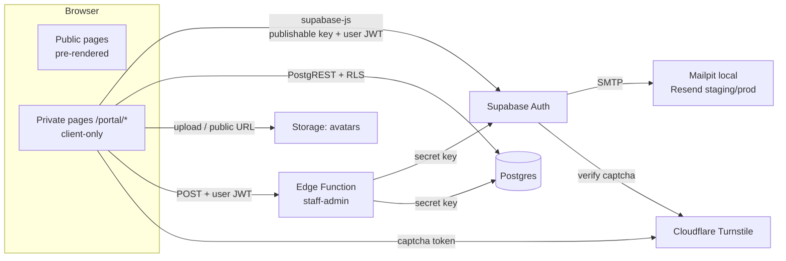
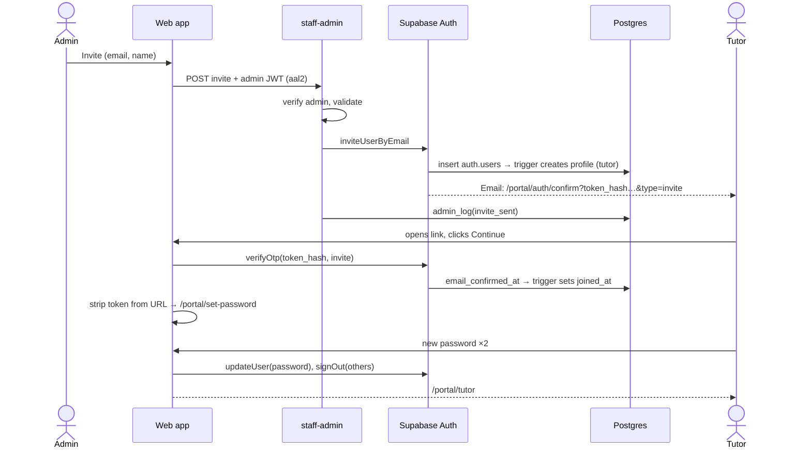
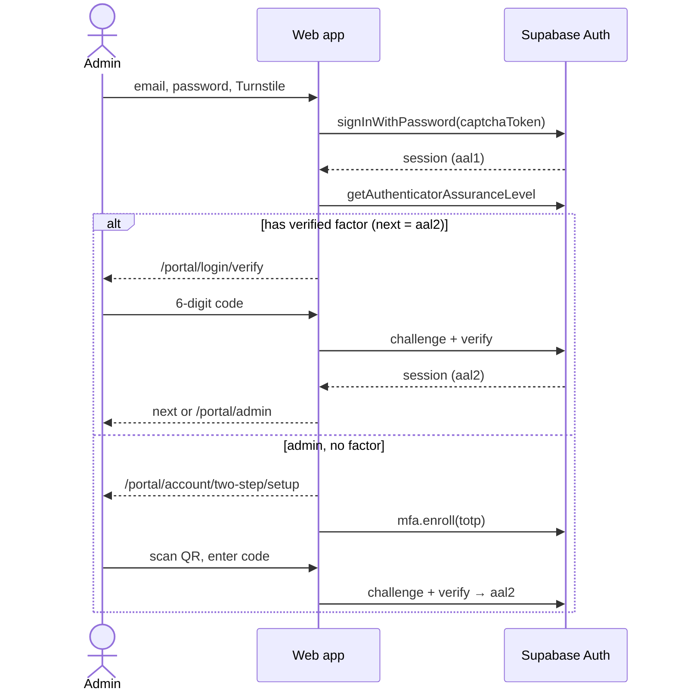
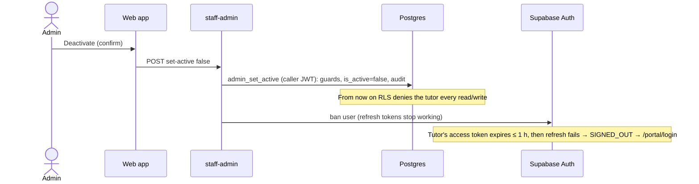

# R2a — Tutor & Admin Logins: Technical Design

> **Status:** Reviewed, ready to build (6 Oct 2026). **No code has been changed yet.**
> **Stories:** [stories.md](stories.md) · **Gap review:** [review.md](review.md) · **PRP:** [../PRP.md](../PRP.md#r2a--tutor--admin-logins) · **Architecture:** [arch.md](../../../architecture/arch.md)
>
> Tags like **(G12)** point to the gap in [review.md](review.md) that a design choice fixes.

## Contents

1. [Scope](#1-scope)
2. [Constraints](#2-constraints)
3. [Architecture Overview](#3-architecture-overview)
4. [Roles, Permissions and Two-Step Sign-In](#4-roles-permissions-and-two-step-sign-in)
5. [Data Model](#5-data-model)
6. [Database Functions and Triggers](#6-database-functions-and-triggers)
7. [Access Rules: RLS, Grants, Storage](#7-access-rules-rls-grants-storage)
8. [Supabase Auth Configuration](#8-supabase-auth-configuration)
9. [Email Links and Templates](#9-email-links-and-templates)
10. [Edge Function `staff-admin`](#10-edge-function-staff-admin)
11. [Web App](#11-web-app)
12. [Key Flows](#12-key-flows)
13. [Hosting, Headers and Privacy](#13-hosting-headers-and-privacy)
14. [Environments, Config and Secrets](#14-environments-config-and-secrets)
15. [Testing](#15-testing)
16. [Operations Runbooks](#16-operations-runbooks)
17. [Complete Change List](#17-complete-change-list)
18. [Build Order](#18-build-order)
19. [Spikes (verify while building)](#19-spikes-verify-while-building)

---

## 1. Scope

**In scope**
- Invite-only staff accounts (tutor, admin): invite, resend, cancel a pending invite.
- Accept invite and set a password; sign in; sign out; forgot password; change password.
- **Two-step sign-in (TOTP authenticator app) required for every admin**, including a backup authenticator, removal, and reset by another admin.
- Route protection for every private page.
- Tutor dashboard shell (placeholder cards for R3).
- Own profile: full name, subjects, bio, qualifications, photo.
- Admin → Staff: list, status, invite, edit a staff profile, change role, deactivate / reactivate, reset two-step.
- Audit log of access changes.
- Hosting rewrites, security headers (including CSP for private pages), noindex, analytics exclusion.
- Local Supabase stack, migrations, seed, database tests, edge function, branded auth emails.

**Out of scope (later)**
- Showing tutor profiles on the public site (data is ready for it; display is a later story).
- Two-step sign-in for tutors (allowed by the platform, not offered in the UI).
- Changing your own email address (done by the developer in the Supabase dashboard if ever needed; the profile copy stays in sync automatically).
- An audit-log viewer page (data is captured now; viewed in the Supabase dashboard).
- Students and parents (R3), testimonials, lead backend, subscribers (rest of R2).
- Session timeouts and the leaked-password check (Supabase Pro features, see [review.md](review.md) Q5).

## 2. Constraints

| Constraint | Effect on the design |
|---|---|
| The public site is **pre-rendered, static, `ssr: false`** | Private pages are client-only routes served through the SPA fallback page. No server code in the web app. |
| **No BFF** (PRP service-layer rule) | The browser talks to Supabase directly. Anything needing a secret runs in a Supabase Edge Function. |
| House rules: readable code, **no magic strings**, theme variables, env only in `app.constants.ts`, **only `src/services/` imports `@supabase/*`** | Every text, path, limit and key lives in `src/constants/`. Services return plain app types. |
| Free tiers ([budget.md](../../../budget.md)) | TOTP two-step is free. Leaked-password check, session timebox and backups are Pro. Free projects pause after 1 week idle (risk, Q5). |
| Hosts: **Railway and Vercel** (owner, 6 Oct). Budget plans Cloudflare Pages | All private paths sit under one prefix, so each host needs one rule (G21, Q3). |

## 3. Architecture Overview



- **Postgres RLS is the security boundary.** The UI hides what you can't do, but every rule is enforced in the database or in the edge function.
- The **edge function** is used only for actions that need the secret key: invite, resend, cancel invite, deactivate / reactivate (ban), reset two-step.
- Public pages never load `supabase-js` (G23).

## 4. Roles, Permissions and Two-Step Sign-In

### 4.1 Roles

| Role | Who | Notes |
|---|---|---|
| `tutor` | Teaching staff | Default for every new account. |
| `admin` | Ajay, and at least one backup admin (Q2) | **Includes everything a tutor can do.** Ajay has one `admin` account and uses both the tutor and admin areas. |

A person has exactly one role, stored in `profiles.role`. A person is **active** when `profiles.is_active = true`.

### 4.2 Two-step rule for admins (G3)

- An admin's **admin powers require an `aal2` session** (password + authenticator code). This is enforced in SQL (`private.is_admin()` checks `auth.jwt() ->> 'aal' = 'aal2'`) and in the edge function, not just in the UI.
- An admin with only `aal1` (password only) has **tutor powers on their own row**, and the UI sends them to two-step setup or verify before showing any private page.
- A tutor promoted to admin must set up two-step the next time they open a private page (G31).
- Each admin may enrol **up to 2 authenticators** (e.g. phone app + password manager) so a lost phone doesn't lock them out (G6).
- If an admin loses every authenticator, **another admin** resets their two-step (audited, and the user gets a "verification method removed" email). If the only admin is locked out, the developer follows the break-glass runbook (§16.3).

### 4.3 Permission matrix

| Capability | Tutor (active) | Admin (active, aal2) | Admin (aal1) | Inactive / signed out |
|---|---|---|---|---|
| Read / edit own profile (name, subjects, bio, qualifications, photo) | ✅ | ✅ | ✅ (UI blocks until two-step) | ❌ |
| Read / edit any staff profile | ❌ | ✅ | ❌ | ❌ |
| Change role, deactivate / reactivate | ❌ | ✅ (guards §6.3) | ❌ | ❌ |
| Invite, resend, cancel invite, reset someone's two-step | ❌ | ✅ | ❌ | ❌ |
| Read audit log | ❌ | ✅ (dashboard / API) | ❌ | ❌ |
| Change own password, manage own authenticators | ✅ | ✅ | ✅ | ❌ |

## 5. Data Model

One migration: `supabase/migrations/20261006000000_staff_accounts.sql`.

```sql
create schema if not exists private;          -- helpers not exposed through the API (G13)

create type public.app_role as enum ('tutor', 'admin');

create table public.profiles (
  id              uuid primary key references auth.users (id) on delete cascade,
  email           text not null,
  full_name       text not null default ''  check (char_length(full_name) <= 100),
  bio             text not null default ''  check (char_length(bio) <= 1000),
  qualifications  text[] not null default '{}'
                  check (cardinality(qualifications) <= 10
                         and private.items_within_length(qualifications, 150)),
  subjects        text[] not null default '{}'
                  check (cardinality(subjects) <= 15
                         and private.items_are_slugs(subjects)),
  avatar_path     text check (avatar_path is null or avatar_path like id::text || '/%'),
  role            public.app_role not null default 'tutor',
  is_active       boolean not null default true,
  invited_at      timestamptz,      -- copied from auth.users
  joined_at       timestamptz,      -- auth.users.email_confirmed_at (invite accepted)
  last_sign_in_at timestamptz,      -- copied from auth.users
  created_at      timestamptz not null default now(),
  updated_at      timestamptz not null default now()
);

create table public.audit_log (
  id          bigint generated always as identity primary key,
  actor_id    uuid references auth.users (id) on delete set null,
  action      text not null check (action in (
                'invite_sent', 'invite_resent', 'invite_cancelled',
                'role_changed', 'deactivated', 'reactivated',
                'two_step_reset', 'profile_edited_by_admin')),
  target_id   uuid references auth.users (id) on delete set null,
  details     jsonb not null default '{}',   -- e.g. {"from":"tutor","to":"admin"}, {"email":"…"}
  created_at  timestamptz not null default now()
);
create index audit_log_target_idx on public.audit_log (target_id, created_at desc);
```

**Field rules**
- `subjects` stores **keys** such as `maths` and `verbal-reasoning`. Labels and the allowed list live in `src/constants/subjects.constants.ts`. The list is not confirmed yet (Q1), so it is **not** a database enum. Adding or renaming a subject is a constants change only. Keys the UI doesn't recognise are kept but not shown (G9).
- `bio` and `qualifications` are **plain text**. They are always rendered as text (React escaping; `white-space: pre-line` for bio line breaks), never as HTML or Markdown (G16).
- `avatar_path` must sit in the user's own folder (`{user id}/…`). This is checked in the database as well as in storage policies (G18).
- `email`, `invited_at`, `joined_at` and `last_sign_in_at` are copies kept in sync by triggers (§6.2), so the admin list never needs to read `auth.users`.

**Derived staff status** (computed in the service layer, not stored):

| Status | Rule |
|---|---|
| Invited | `joined_at is null` and invite sent less than `INVITE_LINK_HOURS` ago |
| Invite expired | `joined_at is null` and invite older than that |
| Active | `joined_at is not null` and `is_active` |
| Deactivated | `is_active = false` |

## 6. Database Functions and Triggers

All functions: `security definer` only where needed, **`set search_path = ''`**, fully qualified names, and `revoke execute … from public, anon` followed by an explicit `grant execute … to authenticated` (G13).

### 6.1 Helpers (`private` schema)

| Function | Returns |
|---|---|
| `private.my_active_role()` | The caller's role if their profile exists **and** is active, else `null`. `stable security definer`. |
| `private.is_active_staff()` | `my_active_role() is not null` |
| `private.is_admin()` | `my_active_role() = 'admin' and auth.jwt() ->> 'aal' = 'aal2'` |
| `private.is_last_active_admin(target uuid)` | True when `target` is the only active admin |
| `private.items_within_length(text[], int)` | Check-constraint helper (`immutable`) |
| `private.items_are_slugs(text[])` | Each item matches `^[a-z][a-z0-9-]{1,39}$` (`immutable`) |

`grant usage on schema private to authenticated;` lets policies call the helpers. PostgREST does not expose the `private` schema, so they are not callable as RPCs.

### 6.2 Triggers

| Trigger | On | Does |
|---|---|---|
| `on_auth_user_created` | `after insert on auth.users` | Inserts the profile: `id`, `lower(email)`, `full_name` from `raw_user_meta_data->>'full_name'` (trimmed, max 100), `invited_at`. Role is always the default `tutor`. **User metadata is never used for anything else** (G2). |
| `on_auth_user_updated` | `after update of email, email_confirmed_at, last_sign_in_at, invited_at on auth.users` | Copies those values into the profile. |
| `profiles_set_updated_at` | `before update on public.profiles` | Sets `updated_at = now()`. |
| `profiles_audit_admin_edit` | `after update on public.profiles` | When `auth.uid()` is set and differs from the row's `id`, writes `profile_edited_by_admin` with the changed column names (not values). `security definer`, because the editing user has no insert grant on `audit_log` (V3). |

### 6.3 Admin RPCs (`public` schema, callable by signed-in users, check `is_admin()` first)

| Function | Rules | Audit |
|---|---|---|
| `am_i_admin()` → boolean | Returns `private.is_admin()` for the caller. Used by the edge function (V1). | — |
| `admin_list_staff()` → setof rows | Returns profile columns plus `has_two_step` (whether a verified factor exists in `auth.mfa_factors`). | — |
| `admin_set_role(target uuid, new_role app_role)` | Takes `pg_advisory_xact_lock` on a fixed key (G4), **then** checks the caller is still an admin (V15). Refuses to demote the **last active admin**. Target must exist and have joined. | `role_changed {from, to}` |
| `admin_set_active(target uuid, active boolean)` | Same lock and order. Refuses to **deactivate yourself** and to deactivate the **last active admin**. Target must have joined. | `deactivated` / `reactivated` |
| `admin_log(actor uuid, action text, target uuid, details jsonb)` | Execute granted to **`service_role` only** (V2). The edge function calls it with the secret key for invite and two-step actions, passing the verified caller as `actor`. | as given |

Errors are raised with a stable message key (`not_admin`, `last_admin`, `cannot_deactivate_self`, `not_found`, `not_joined`) so services can map them to friendly text (G28).

## 7. Access Rules: RLS, Grants, Storage

### 7.1 Grants (G1)

Supabase grants `anon` and `authenticated` full table privileges by default. RLS blocks rows, but columns need explicit grants too, so the migration resets them:

```sql
alter table public.profiles  enable row level security;
alter table public.audit_log enable row level security;

revoke all on public.profiles, public.audit_log from anon, authenticated;
grant select on public.profiles to authenticated;
grant update (full_name, bio, qualifications, subjects, avatar_path) on public.profiles to authenticated;
grant select on public.audit_log to authenticated;          -- RLS limits to admins
```

Nobody can `insert` or `delete` profiles through the API, or update `role`, `is_active`, `email` or the synced dates (G1, G2).

### 7.2 Policies

| Table | Action | Policy (`to authenticated`) |
|---|---|---|
| `profiles` | select | `(id = (select auth.uid()) and (select private.is_active_staff())) or (select private.is_admin())` |
| `profiles` | update | same `using` and `with check` |
| `audit_log` | select | `(select private.is_admin())` |

Helpers are wrapped in `(select …)` so Postgres evaluates them once per query.

### 7.3 Storage bucket `avatars` (G18)

Created in the migration (so every environment gets it):

| Setting | Value |
|---|---|
| `public` | `true`. Photos are meant for the public site later; the profile page says so. |
| `file_size_limit` | 2 MB |
| `allowed_mime_types` | `image/jpeg`, `image/png`, `image/webp` (**no SVG**, it can carry scripts) |

Policies on `storage.objects` (`to authenticated`, `bucket_id = 'avatars'`) for select, insert, update, delete:

```sql
((storage.foldername(name))[1] = (select auth.uid())::text and (select private.is_active_staff()))
or (select private.is_admin())
```

- **Before upload, the browser resizes the photo to at most 512 × 512 and re-encodes it as WebP** (canvas). This removes location data (EXIF GPS) from phone photos, keeps files small, and guarantees the bytes are a real image, since storage trusts the declared type (V16).
- Files are named `{user id}/{timestamp}.webp`. A new photo gets a new name, so CDN caches never show the old one. After the profile is updated, the service deletes the previous file. If that fails, the orphan is harmless and is cleaned up next time (G34).
- `anon` has no select policy, so nobody can list the bucket. A public URL only works if you already know the path.

## 8. Supabase Auth Configuration

Committed in `supabase/config.toml` (local). Staging and prod get the same values (§14.2).

| Setting | Value | Why |
|---|---|---|
| `auth.enable_signup` | `false` | Invite only (D1). Admin invites still work. **`auth.email.enable_signup` stays `true`**: despite its name it turns the whole email provider on or off, sign-in included (V17). |
| `auth.enable_anonymous_sign_ins` | `false` | — |
| `auth.minimum_password_length` | **12** | Raised from 10 (G10). No composition rules (NIST). |
| `auth.password_requirements` | `""` | Length over complexity. |
| `auth.jwt_expiry` | `3600` | Default. Data access is cut immediately on deactivation anyway (G11). |
| `auth.enable_refresh_token_rotation` | `true` | Default. |
| `auth.email.secure_password_change` | `true` | Sessions older than 24 h need a re-authentication code. The app asks for one every time anyway, because Supabase ignores a `current_password` (V19). |
| `auth.email.double_confirm_changes` | `true` | Email change needs both addresses to confirm. |
| `auth.email.max_frequency` | `"60s"` | Limits reset-email bombing (G8). |
| `auth.email.otp_expiry` | `3600` | Invite and reset links last **1 hour** (Q4). Admins can resend an invite. |
| `auth.rate_limit.email_sent` | `30` per hour | Requires custom SMTP (Resend). |
| `auth.rate_limit.sign_in_sign_ups` | `30` per 5 min per IP | Default. |
| `auth.rate_limit.token_verifications` | `30` per 5 min per IP | Default (email links). Two-step codes have a separate, fixed hosted limit of 15 a minute per IP, which the local stack doesn't apply (V20). |
| `auth.captcha` | `enabled`, `provider = "turnstile"` | Login and forgot-password need a captcha token (G8). Local uses Turnstile's always-pass test keys. |
| `auth.mfa.max_enrolled_factors` | `3` | 2 authenticators + 1 pending enrolment. |
| `auth.mfa.totp.enroll_enabled`, `verify_enabled` | `true` | Admin two-step. |
| `auth.site_url` | per environment | Used in email links. |
| `auth.additional_redirect_urls` | exact list per environment | No wildcards. |
| Notifications: `password_changed`, `email_changed`, `mfa_factor_enrolled`, `mfa_factor_unenrolled` | enabled | Tells the owner of the account when something security-relevant changes (G19). |
| Email templates | `invite`, `recovery`, `reauthentication`, `magic_link`, `email_change` + the four notifications | All branded (§9). `magic_link` is not used by the app but is branded in case Supabase sends it. |

Turnstile is chosen over hCaptcha because the budget and the rest of R2 already plan Turnstile (contact form backend), and it is free and cookieless. The public forms keep hCaptcha until the R2 contact form backend moves them.

## 9. Email Links and Templates

### 9.1 Token-hash links with a "Continue" button (G5)

The usual one-click links fail in two ways:
1. **Email scanners open links first**, which uses up the single-use token.
2. **PKCE links only work in the browser that requested them**, and `inviteUserByEmail` doesn't support PKCE at all.

So the invite and recovery templates link to **our** page:

```
{{ .SiteURL }}/portal/auth/confirm?token_hash={{ .TokenHash }}&type=invite
{{ .SiteURL }}/portal/auth/confirm?token_hash={{ .TokenHash }}&type=recovery
```

`/portal/auth/confirm` shows a heading and a **Continue** button. Only a click calls `verifyOtp({ token_hash, type })`. A scanner that loads the page doesn't use up the token. Then the page:
1. Removes the token from the address bar (`history.replaceState`) (G12).
2. Goes to `/portal/set-password` (session in memory/storage, no token in the URL).
3. On failure shows "This link has expired or has already been used", with **Request a new link** (recovery) or **Ask AJ Classes to resend your invite** (invite).

### 9.2 Templates

`supabase/templates/*.html`: simple, inline-styled, logo, one button, plain wording, "This link expires in 1 hour", "If you didn't expect this email, you can ignore it." Brand colours are copied from `theme.css` with a comment (emails can't read CSS variables). Subjects are set in `config.toml`.

The **magic-link email carries no token on purpose**: it points to `/portal/login`. Staff always sign in with a password (plus a code for admins), so an email-only way in must not exist (V22).

## 10. Edge Function `staff-admin`

One function, small handler files: `supabase/functions/staff-admin/`.

```
staff-admin/
  index.ts              CORS, method check, parse {action, ...}, route to handler
  handlers/invite.ts
  handlers/resend-invite.ts
  handlers/cancel-invite.ts
  handlers/set-active.ts
  handlers/reset-two-step.ts
_shared/
  cors.ts               allowed origins from env ALLOWED_ORIGINS (exact list)
  auth.ts               requireActiveAdmin(req): verifies the caller's JWT (getClaims), aal2, calls private check via user client
  clients.ts            userClient(req) and adminClient() (secret key)
  validation.ts         email + name checks
  responses.ts          json(), error(code, status)
```

**Every request** (G15):
1. `OPTIONS` → CORS preflight for allowed origins only. Other origins get no CORS headers.
2. Only `POST` with JSON.
3. `requireActiveAdmin`: verifies the JWT (`getClaims`), checks `aal = aal2`, then calls `rpc('am_i_admin')` with the **caller's own** client, so the database decides (active admin). Failure → `403`.
4. Validate the input. Failure → `400` with a field key.
5. Do the action. Return `{ ok: true, data }` or `{ ok: false, code }`.

| Action | Input | Steps | Errors |
|---|---|---|---|
| `invite` | `email`, `fullName` | Normalise the email (trim, lower case). If a profile with that email exists → `409 already_exists` with its status. `auth.admin.inviteUserByEmail(email, { data: { full_name } })`. `admin_log('invite_sent')`. | `already_exists`, `invalid_email`, `invalid_name`, `email_failed` |
| `resend-invite` | `userId` | Only when `joined_at is null`. Re-send the invite (SP1). `admin_log('invite_resent')`. | `already_joined`, `not_found` |
| `cancel-invite` | `userId` | Only when `joined_at is null` **and** `last_sign_in_at is null` (G24). `auth.admin.deleteUser`. `admin_log('invite_cancelled', details {email})` (target is null after delete, so the email is kept). | `already_joined`, `not_found` |
| `set-active` | `userId`, `active` | **Deactivate:** `rpc('admin_set_active', false)` with the **caller's** client (DB guards + audit), then ban with `auth.admin.updateUserById(id, { ban_duration: '876000h' })`. **Reactivate:** unban (`ban_duration: 'none'`) first, then the RPC. In both orders a half-finished action leaves the user **without** access (G26). | `last_admin`, `cannot_deactivate_self`, `ban_failed` |
| `reset-two-step` | `userId` | Not yourself (use Account → Two-step). List the target's factors with the admin API and delete each. `admin_log('two_step_reset')`. The target gets the "verification method removed" email (G19). | `cannot_reset_self`, `not_found` |

Role changes don't need a secret, so the web app calls `admin_set_role` directly.

**Which actions apply to whom (V14):** someone who hasn't joined yet gets **Resend invite** and **Cancel invite** only. Someone who has joined gets **Role**, **Deactivate / Reactivate** and **Reset two-step**. The function refuses actions that don't match the person's state.

## 11. Web App

### 11.1 One private prefix: `/portal` (G21)

Every private and auth page lives under `/portal`. That gives **one** rewrite rule per host, **one** `Disallow` in `robots.txt`, **one** noindex header, **one** CSP rule and **one** analytics exclusion. R3 students and parents can reuse the same prefix.

| Path | Page | Who |
|---|---|---|
| `/portal` | Redirects by role (admin → `/portal/admin`, tutor → `/portal/tutor`) | signed in |
| `/portal/login` | Email, password, Turnstile | signed out |
| `/portal/login/verify` | Authenticator code | `aal1` with a verified factor |
| `/portal/forgot-password` | Email, Turnstile | anyone |
| `/portal/auth/confirm` | Continue button for invite / reset links (§9.1) | anyone with a link |
| `/portal/set-password` | New password twice | session from a link |
| `/portal/account` | Change password; two-step status and authenticators | signed in |
| `/portal/account/two-step/setup` | QR code, secret key, code to confirm | signed in |
| `/portal/profile` | Own profile | signed in |
| `/portal/tutor` | Tutor dashboard | tutor, admin |
| `/portal/admin` | Admin dashboard: counts and links | admin |
| `/portal/admin/staff` | Staff table + Invite | admin |
| `/portal/admin/staff/:userId` | Profile, Access (role, active), Invite (resend / cancel), Two-step (reset) | admin |

### 11.2 Route structure (`src/routes.ts`)

```ts
...prefix(PORTAL_ROUTES.root, [
  layout('routes/portal/public-layout.tsx', [        // auth pages, minimal card layout
    route('login', 'routes/portal/login.tsx'),
    route('login/verify', 'routes/portal/login-verify.tsx'),
    route('forgot-password', 'routes/portal/forgot-password.tsx'),
    route('auth/confirm', 'routes/portal/auth-confirm.tsx'),
    route('set-password', 'routes/portal/set-password.tsx'),
  ]),
  layout('routes/portal/private-layout.tsx', [       // guard + PortalLayout
    index('routes/portal/home.tsx'),
    route('account', 'routes/portal/account.tsx'),
    route('account/two-step/setup', 'routes/portal/two-step-setup.tsx'),
    route('profile', 'routes/portal/profile.tsx'),
    route('tutor', 'routes/portal/tutor-dashboard.tsx'),
    layout('routes/portal/admin-layout.tsx', [       // role guard
      route('admin', 'routes/portal/admin-dashboard.tsx'),
      route('admin/staff', 'routes/portal/admin-staff.tsx'),
      route('admin/staff/:userId', 'routes/portal/admin-staff-member.tsx'),
    ]),
  ]),
]),
```

The path strings come from `PORTAL_ROUTES` in `routes.constants.ts`. None of these are added to the `prerender` list, so the build serves them through `__spa-fallback.html` (already produced today).

### 11.3 Guards (G27)

Guards are **`clientLoader`s on the layout routes**, built from one pure function so the rules are unit-tested:

```ts
decidePortalAccess(state: AccessState, area: 'auth' | 'staff' | 'admin', path: string): Allow | Redirect | Forbidden
```

`AccessState` = `{ signedIn, profile: { role, isActive } | null, aal: 'aal1' | 'aal2', hasVerifiedFactor }`.

| # | Situation | Result |
|---|---|---|
| 1 | Not signed in, private area | Redirect `/portal/login?next={path}` |
| 2 | Signed in, profile missing or inactive | Sign out, redirect `/portal/login?reason=inactive` |
| 3 | Has a verified factor, session `aal1` | Redirect `/portal/login/verify?next={path}` |
| 4 | Admin with no verified factor | Redirect `/portal/account/two-step/setup` (the setup page itself, and sign out, are allowed) |
| 5 | Admin area, role tutor | **Forbidden** view ("You don't have access to this page") |
| 6 | Auth area (`login`, `forgot-password`), fully signed in | Redirect to home for role |
| 7 | `set-password` with no session | Redirect `/portal/login` |
| 8 | Otherwise | Allow |

**`next` handling (G7):** `safeNextPath(next)` accepts only same-origin paths that start with `/portal/`, are not `//…` or `/\…`, and have no scheme. Anything else falls back to the role's home.

**Freshness:** there is no cache. Every guarded page reads the session, profile and two-step level fresh (`getAccessState()`, two small requests), so a role change or deactivation applies on the next click. This is simpler and never stale (changed while building, 7 Oct). A `SIGNED_OUT` event (sign-out in another tab, or a failed refresh after a ban) sends the user to `/portal/login` (G29). A signed-in user whose own profile can no longer be read (deactivated while the page was open) is treated as inactive: signed out and sent to `/portal/login?reason=inactive` (V7, G11).

Every guarded route exports a `HydrateFallback` (small loading state) because loaders run before the first render in SPA mode.

### 11.4 Services (`src/services/`) (G23, G28)

`supabase.client.ts` exports **`getSupabase()`**, which creates the client on first call. There is no top-level `createClient`, so:
- importing `@/services` on public pages doesn't pull `supabase-js` into their bundles (verified in §15), and
- pre-rendering in Node never fails for a missing env var.

| File | Functions (all return `Result<T>` = `{ ok: true, data } \| { ok: false, error: ErrorKey }`) |
|---|---|
| `auth.service.ts` | `signIn(email, password, captchaToken)`, `signOut()` (this device), `requestPasswordReset(email, captchaToken)`, `confirmEmailLink(tokenHash, type)`, `setNewPassword(password)`, `changePassword(newPassword, emailedCode?)` + `sendReauthCode()` (V21: the code is asked for only when Supabase requires it), `getAccessState()`, `watchForSignOut(callback)` |
| `two-step.service.ts` | `startTwoStepSetup(label)` → `{ factorId, qrSvg, secret }`, `confirmTwoStepSetup(factorId, code)`, `verifyTwoStep(factorId, code)` (the page asks which authenticator when there are two, V11), `listAuthenticators()`, `removeAuthenticator(factorId)` (refused for an admin's last verified authenticator, V12). Unverified leftover enrolments are removed before a new setup starts. |
| `profile.service.ts` | `getMyProfile()`, `updateMyProfile(changes)`, `uploadMyPhoto(file)`, `photoUrl(path)` |
| `staff.service.ts` | `listStaff()`, `getStaffMember(id)`, `updateStaffProfile(id, changes)`, `inviteStaff(email, fullName)`, `resendInvite(id)`, `cancelInvite(id)`, `setStaffRole(id, role)`, `setStaffActive(id, active)`, `resetStaffTwoStep(id)` |
| `auth-errors.ts` | Maps Supabase error **codes** (not messages), e.g. `invalid_credentials`, `user_banned`, `over_request_rate_limit`, `captcha_failed`, `weak_password`, `same_password`, `mfa_verification_failed`, plus our RPC and function keys, to `ErrorKey`s whose text lives in `error.constants.ts` |
| `database.types.ts` | Generated by `supabase gen types`; imported only inside services |
| `types.ts` | `StaffRole`, `StaffStatus`, `StaffProfile`, `StaffMember`, `Authenticator`, `AccessState`, `Result<T>` |

**Sign-in messages (G17, V18):** wrong email, wrong password **and a deactivated (banned) account** all give "Email or password is incorrect." Supabase reports a ban before it checks the password, so a separate message would reveal which emails belong to deactivated staff. "Your account is not active. Please contact AJ Classes." appears only when sign-in succeeds but the profile is inactive (e.g. the ban step failed), or on `?reason=inactive` after being signed out.

**Setting a password when two-step is on (V19):** Supabase refuses a password change from a password-only (`aal1`) session if the account has a verified authenticator. So `/portal/set-password` (recovery link) first asks for the authenticator code, then saves the password.

**After a password is set or changed:** `signOut({ scope: 'others' })` ends every other session (G25).

### 11.5 Components

| Component | Folder | Purpose |
|---|---|---|
| `PortalLayout` | `components/portal/` | Header (logo, the user's name, Sign out), nav (Tutor: Dashboard, My profile, Account. Admin adds Staff and Admin home), main area. No marketing header or footer. |
| `AuthCard` | `components/portal/` | Centred card for login and similar pages |
| `PasswordField` | `components/portal/` | Show/hide toggle, `autocomplete` set by use (`current-password` / `new-password`) |
| `CodeField` | `components/portal/` | 6-digit code: `inputmode="numeric"`, `autocomplete="one-time-code"` |
| `TurnstileField` | `components/ui/` | Loads Turnstile only where used. Resets after a failed submit (tokens are single use). |
| `SubjectPicker` | `components/portal/` | Checkbox group from `SUBJECTS` |
| `TextListEditor` | `components/portal/` | Add/remove lines (qualifications), max 10 × 150 chars |
| `PhotoUpload` | `components/portal/` | Type check, resize to ≤ 512 px and re-encode as WebP (V16), preview, "may be shown on the public website" note |
| `StatusBadge` | `components/portal/` | Invited / Invite expired / Active / Deactivated |
| `ConfirmDialog` | `components/ui/` | Native `<dialog>`, focus-trapped, for role, deactivate, cancel invite, reset two-step |
| `ForbiddenView`, `PortalUnavailable` | `components/portal/` | No access; portal not configured (G30) |

Forms reuse the R1 pattern (`FormField`, inline errors with `aria-describedby`, error summary, focus moves to the first error). On route change, focus moves to the page `<h1>`.

### 11.6 Constants and styles

| File | Adds |
|---|---|
| `routes.constants.ts` | `PORTAL_ROUTES`, `PORTAL_PATH_PREFIX`, `homeForRole(role)` |
| `app.constants.ts` | `SUPABASE_CONFIG { url, publishableKey }`, `TURNSTILE_CONFIG { siteKey }`, `features.portal` (true only when the Supabase URL, publishable key **and** Turnstile site key are all set, V6), `AUTH_LIMITS { passwordMin: 12, inviteLinkHours: 1, codeLength: 6, maxAuthenticators: 2 }`, `PROFILE_LIMITS`, `PHOTO_LIMITS { maxBytes, types }`, `STAFF_ROLES` |
| `subjects.constants.ts` | `SUBJECTS` key → label. **Placeholder list marked "to be confirmed by owner" (Q1).** |
| `portal.constants.ts` | Every word on portal pages, by page |
| `error.constants.ts` | `AUTH_ERRORS`, `STAFF_ERRORS`, `PROFILE_ERRORS` |
| `seo.constants.ts` | Titles for portal pages (`noindex` meta in the portal layouts, reusing `noIndexMeta()` from `lib/seo.ts`) |
| `theme.css` | Only if needed: `--color-warning` and `--color-warning-bg` for the "Invite expired" badge. Everything else reuses existing variables. |

### 11.7 Changes to existing public files

| File | Change |
|---|---|
| `root.tsx` | Don't render `<Analytics />` when the path starts with `/portal` (G12, G20). |
| `Footer.tsx` | A small "Staff sign in" link to `/portal/login`, only when `features.portal` is on. |
| `routes/robots.ts` | `Disallow: /portal` |
| `routes/sitemap.ts` | No change (portal is not in it); test asserts this. |
| `eslint.config.js` | Add `react/no-danger: error` (G16). Supabase import rule already exists. |
| `.env.example` | `VITE_SUPABASE_URL`, `VITE_SUPABASE_PUBLISHABLE_KEY`, `VITE_TURNSTILE_SITE_KEY` |

## 12. Key Flows

### 12.1 Invite → accept → first sign-in



### 12.2 Admin sign-in with two-step



### 12.3 Deactivate a tutor



## 13. Hosting, Headers and Privacy

### 13.1 Rewrites (both hosts)

| Host | File | Rule |
|---|---|---|
| Vercel | `apps/web/vercel.json` | `rewrites: [{ "source": "/portal/:path*", "destination": "/__spa-fallback.html" }]` (`:path*` also matches `/portal`) |
| Railway | `apps/web/serve.railway.json` | `rewrites: [{ "source": "/portal", "destination": "/__spa-fallback.html" }, { "source": "/portal/**", "destination": "/__spa-fallback.html" }]`. `serve` matches header rules against the **rewritten file**, so the portal headers use `"source": "__spa-fallback.html"` (V23). |
| Cloudflare Pages (if adopted, Q3) | `apps/web/public/_redirects` | `/portal/* /__spa-fallback.html 200` |

Unknown public URLs still get the pre-rendered 404 page. Unknown `/portal/...` URLs get the in-app 404.

### 13.2 Headers for `/portal/*`

| Header | Value |
|---|---|
| `X-Robots-Tag` | `noindex, nofollow` |
| `Cache-Control` | `no-store` (the fallback HTML; hashed assets keep long caching) |
| `Content-Security-Policy` (G22) | `default-src 'self'; script-src 'self' 'unsafe-inline' https://challenges.cloudflare.com; style-src 'self' 'unsafe-inline'; font-src 'self'; img-src 'self' data: https://{project}.supabase.co; connect-src 'self' https://{project}.supabase.co; frame-src https://challenges.cloudflare.com; frame-ancestors 'none'; base-uri 'self'; form-action 'self'; object-src 'none'` |
| Existing | HSTS, `nosniff`, `X-Frame-Options: DENY`, `Referrer-Policy: strict-origin-when-cross-origin` (already on all paths) |

Until the staging and prod projects exist, the CSP allows `https://*.supabase.co`; replace it with the exact project host once known. A production build served locally can't reach the **local** Supabase because of this CSP, so local testing uses `pnpm dev`.

`'unsafe-inline'` for scripts is needed because React Router inlines its startup script. Replacing it with build-time hashes is an R2 hardening task. The strict `connect-src`, `img-src` and `frame-src` still stop a script from sending a stolen session to another site through those routes. The `{project}` host comes from the environment (§14).

### 13.3 Privacy

- No analytics on `/portal/*` (no URLs with tokens, no staff browsing data).
- Errors and logs never include passwords, codes or tokens.
- Staff data (names, bios, qualifications, photos) is employment information. The public privacy page doesn't change in R2a. It will be updated when family data moves to Supabase (rest of R2).

## 14. Environments, Config and Secrets

### 14.1 Variables

| Name | Where | Secret? | Local | Staging / prod |
|---|---|---|---|---|
| `VITE_SUPABASE_URL` | web build | no | `http://127.0.0.1:54321` | project URL |
| `VITE_SUPABASE_PUBLISHABLE_KEY` | web build | no (public by design; RLS protects data) | from `supabase status` | project publishable key |
| `VITE_TURNSTILE_SITE_KEY` | web build | no | `1x00000000000000000000AA` (test, always passes) | real site key |
| Turnstile secret | Supabase Auth captcha setting | **yes** | test secret | dashboard / `env()` |
| Resend SMTP password | Supabase Auth SMTP | **yes** | — (Mailpit) | dashboard / `env()` |
| `SUPABASE_SECRET_KEY` (service role) | edge function | **yes** | provided by the CLI | provided by the platform (SP5) |
| `ALLOWED_ORIGINS` | edge function | no | `http://localhost:5173` | site origins |

**Rules (G14):** secrets never use the `VITE_` prefix; `supabase/functions/.env` and `supabase/.env` are git-ignored; a test fails the build if `dist` contains `service_role`, `sb_secret_` or the word `SUPABASE_SECRET_KEY`.

### 14.2 Environments

| | Local | Staging | Prod |
|---|---|---|---|
| Supabase | `supabase start` (Docker) | Free project, Sydney | Free project, Sydney (Pro before real family data, Q5) |
| Email | Mailpit `http://127.0.0.1:54324` | Resend (shared domain) | Resend |
| Web | `pnpm dev` | Railway (noindex everywhere) | Vercel (Q3) |
| Schema | `supabase db reset` | `supabase db push` (manual until CI) | `supabase db push` after staging sign-off |
| Auth settings | `config.toml` | `supabase config push` per project (SP9) | same |

## 15. Testing

| Layer | Tool | Covers |
|---|---|---|
| Database | **pgTAP** (`supabase test db`, files in `supabase/tests/`) | Every row of the RLS matrix (§7.2) as tutor / admin aal1 / admin aal2 / inactive / anon, by setting `request.jwt.claims`. Column grants (role update denied). RPC guards (last admin, self-deactivate, concurrent demotion via two sessions where practical). Triggers (profile created, sync, audit). Storage policies (own folder only). Grants on `private` functions. |
| Edge function | Deno tests | Input validation, CORS allowlist, `requireActiveAdmin` with fake clients, each handler's order of operations (deactivate: RPC then ban). |
| Web unit | Vitest + Testing Library | `decidePortalAccess` (every row of §11.3), `safeNextPath`, `auth-errors` mapping, staff status rules, form validation, `PhotoUpload` checks, services with a mocked client. |
| Build checks | Vitest / script | Public route chunks don't contain `supabase` (G23). No secret strings in `build/` (G14). `sitemap.xml` has no `/portal`. `robots.txt` disallows `/portal`. |
| End to end | **Playwright, local only in R2a** (CI arrives with R2 hardening) against `supabase start`, with the production build served by `serve` + `serve.railway.json` (so the Railway rewrites and headers are tested; Vercel's are checked by hand after deploy, V8) | Invite → Mailpit → accept → set password → tutor dashboard. Admin sign-in with TOTP (codes generated from the enrolment secret with `otpauth`). Guards: signed-out redirect with `next`, tutor blocked from admin. Deactivate → tutor's next action fails. Refresh on a deep `/portal` URL. Accessibility scan of each portal page with `@axe-core/playwright` (V9). |
| Manual | Checklist in [stories.md](stories.md) | Real email on staging (Resend, spam folder), real authenticator apps (Google Authenticator, 1Password), mobile layout, screen reader pass on login and profile. |

`pnpm check` gains `pnpm db:test` (needs Docker), and the README explains how to run it.

## 16. Operations Runbooks

Kept in `supabase/README.md`.

1. **First admin on a new environment.** Invite the person from the Supabase dashboard (Authentication → Invite). After they accept, run `update public.profiles set role = 'admin' where email = '…';` in the SQL editor (runs as `postgres`, so the column grant doesn't apply). They set up two-step on first sign-in. Locally, `seed.sql` creates `admin@local.test`, `tutor@local.test` and `inactive@local.test` with a known local-only password.
2. **Second admin.** Make at least two admins so one can reset the other's two-step (Q2).
3. **Break-glass: the only admin lost every authenticator.** The developer deletes the factors in the Supabase dashboard (Authentication → user → MFA factors) after confirming identity by phone. Write an `audit_log` row by hand with details `{"via":"break-glass"}`.
4. **Someone leaves.** Admin → Staff → Deactivate. Check the audit log. Their photo stays in storage until removed.
5. **Deploy schema.** `supabase db push --linked` to staging, test, then prod. Never edit an applied migration; add a new one.
6. **Free-tier pause.** A paused project means nobody can sign in. Resume it in the dashboard, and move to Pro before real use (Q5).

### 16.1 Local development: two-step without typing codes (CR1, 7 Oct)

Asked for by the owner: no two-step prompts when developing locally. **Production behaviour does not change.**

- `supabase/seed.sql` gives `admin@local.test` a confirmed authenticator with a fixed, local-only key.
- `apps/web/.env.development.local` (git-ignored, loaded **only** by the dev server, never by `pnpm build`) holds that key as `VITE_LOCAL_ADMIN_TWO_STEP_KEY`.
- On the code step, the dev server works out the current 6-digit code from that key and submits it. The admin goes from password straight to the admin page, and still gets a real two-step (`aal2`) session, so local runs exercise the same rules as prod.
- The shortcut only runs when `import.meta.env.DEV` is true, which a production build replaces with `false`: the key and its variable name are absent from the build (checked), and the small code generator that remains can never run. Database rules, RLS and the pgTAP tests are untouched.
- `newadmin@local.test` is an admin **without** an authenticator, for testing the setup flow by hand.

Rejected: a database switch that skips the `aal2` check (the same code would ship to prod, so one wrong setting would remove two-step there), and a weaker `is_admin()` in the seed (the local database tests would stop testing the real rule).

## 17. Complete Change List

**New**

```
supabase/
  config.toml
  README.md                          runbooks (§16), local commands
  seed.sql                           local test users only
  migrations/20261006000000_staff_accounts.sql
  templates/invite.html, recovery.html, reauthentication.html, magic_link.html, email_change.html,
            password_changed.html, email_changed.html, mfa_factor_enrolled.html, mfa_factor_unenrolled.html
  tests/profiles_rls.test.sql, admin_functions.test.sql, triggers.test.sql, avatars_storage.test.sql
  functions/staff-admin/index.ts, handlers/*.ts, *_test.ts
  functions/_shared/cors.ts, auth.ts, clients.ts, validation.ts, responses.ts
apps/web/src/
  services/supabase.client.ts, auth.service.ts, two-step.service.ts, profile.service.ts,
           staff.service.ts, auth-errors.ts, database.types.ts (+ *.test.ts)
  lib/portal-access.ts (decidePortalAccess, safeNextPath), staff-status.ts (+ tests)
  constants/portal.constants.ts, subjects.constants.ts
  components/portal/*, components/ui/TurnstileField.tsx, components/ui/ConfirmDialog.tsx
  routes/portal/*.tsx (13 pages + 3 layouts)
apps/web/e2e/*.spec.ts, apps/web/playwright.config.ts
```

**Changed**

```
apps/web/src/routes.ts, root.tsx, routes/robots.ts
apps/web/src/constants/routes.constants.ts, app.constants.ts, error.constants.ts, seo.constants.ts, index.ts
apps/web/src/services/index.ts, types.ts
apps/web/src/components/layout/footer/Footer.tsx
apps/web/src/styles/theme.css            (only if a warning colour is needed)
apps/web/eslint.config.js                (react/no-danger)
apps/web/vercel.json, apps/web/serve.railway.json
apps/web/.env.example, apps/web/package.json (@supabase/supabase-js; dev: @playwright/test, @axe-core/playwright, otpauth)
package.json                             (db:start, db:stop, db:reset, db:test, db:types, e2e)
.gitignore                               (supabase/.branches, supabase/.temp, supabase/**/.env)
README.md                                (Getting started with Supabase, house rules unchanged)
docs/requirements/release-2/PRP.md       (R2a summary + links)
```

`react-router.config.ts` does **not** change: portal routes are deliberately not pre-rendered.

## 18. Build Order

Each step ends with `pnpm check` green and a commit.

1. **Database:** `supabase init`, `config.toml`, migration, seed, pgTAP tests. Spikes SP3, SP4, SP8.
2. **Client foundations:** `supabase.client.ts`, types, `auth-errors`, constants, ESLint rule, build checks (G14, G23).
3. **Hosting + guards:** `/portal` routes, layouts, `decidePortalAccess`, `safeNextPath`, rewrites on both hosts, headers, robots, analytics exclusion. Spike SP6.
4. **Sign-in flows:** login (Turnstile, SP7), forgot password, confirm link, set password, sign out, change password (SP2), email templates.
5. **Two-step:** setup, verify, manage authenticators, guard rules 3–4.
6. **Profile:** own profile, subjects, bio, qualifications, photo.
7. **Staff admin:** edge function (SP1, SP5), staff list, member page, invite / resend / cancel, role, deactivate, reset two-step, audit.
8. **End to end + docs:** Playwright suite, README, `supabase/README.md`, manual checklist on staging once it exists.

## 19. Spikes (verify while building)

These are behaviours of Supabase or React Router that the design relies on and that docs don't settle. Each is checked at the start of the build step that needs it; if the result differs, the design and stories are updated before going on.

**Results so far (6 Oct, local stack, CLI 2.99):**

| ID | Result | Effect |
|---|---|---|
| SP2 | Supabase **ignores** `current_password`. It also ignores the emailed `nonce` unless the session is **over 24 hours old**; then a wrong code is refused (`reauthentication_not_valid`). | Change password asks for the code only when Supabase replies `reauthentication_needed` (V21). |
| SP3 | A banned user gets `user_banned` **before** the password is checked. A ban blocks token refresh (`Invalid Refresh Token: User Banned`). The old access token keeps working until it expires, but RLS already denies a deactivated profile. | Banned shows the generic sign-in message (V18). Deactivation flow confirmed. |
| SP4 | Delete works with the single `for all` storage policy. | No change. |
| SP7 | Turnstile test secret + dummy token passes; a missing token fails with `500 unexpected_failure` ("captcha verification process failed"). | Map that case to "Please complete the I am human check". |
| SP8 | Recovery session is `aal1`; for an account with two-step, updating the password returns `401 insufficient_aal`. | `/portal/set-password` asks for the authenticator code first (V19). |
| SP6 | Yes. With `serve` + `serve.railway.json`, every `/portal/...` deep link returns the app (200), unknown public URLs still return the 404 page, and the portal renders under the CSP with Turnstile working. Vercel is checked by hand after deploy. | Header rule fix (V23). |
| SP10 | Locally, 45 wrong codes in a row are all accepted as attempts (no limit). Hosted: 15/min per IP, not configurable. The lockout hook is Team/Enterprise only. | Accepted risk, see review §5 (V20). |
| — | `banned_until = 'infinity'` breaks sign-in with a database error. | Seed and function use a 100-year ban (`876000h`). |

| ID | Question | Fallback if "no" |
|---|---|---|
| SP1 | Does calling `inviteUserByEmail` again for an invited-but-not-joined user re-send the invite? And if the email fails to send, is the user still created (V10)? | `auth.admin.generateLink({ type: 'invite' })` and send the email through Resend's API from the function (local: Mailpit SMTP). If a failed send leaves no user, the invite simply reports the error. |
| SP2 | With `secure_password_change`, how does a signed-in user change their password (a `current_password` option, or `reauthenticate()` + emailed code)? | Use `reauthenticate()` and ask for the emailed code. |
| SP3 | What error code does `signInWithPassword` return for a banned user, and does a ban stop the next token refresh? | Rely on RLS (`is_active`) plus the client signing out when the profile can't be read. |
| SP4 | Does deleting from storage need a `select` policy as well as `delete`? | Policies already include `select` for own folder. |
| SP5 | How does the edge function verify the caller with the new JWT signing keys (`getClaims`), and what is the secret-key env var name? | `verify_jwt = true` in function config + `auth.getUser()`. |
| SP6 | Do non-pre-rendered child routes with `clientLoader` work through `__spa-fallback.html` on both `serve` and Vercel? | Pre-render a single `/portal` shell page and rewrite to it. |
| SP7 | Does Supabase's Turnstile check work with the always-pass test secret locally? | Turn captcha off locally only; keep it on in staging and prod. |
| SP8 | Can an admin with a verified factor set a new password from an `aal1` recovery session? | Ask for the authenticator code on `/portal/set-password` before updating. |
| SP9 | Does `supabase config push` apply auth settings (captcha, MFA, SMTP, templates) to a remote project, with per-project values? | Apply them by hand in the dashboard using a checklist in `supabase/README.md`. |
| SP10 | How many wrong TOTP codes does Supabase allow before rate limiting (V13)? | Accept the `token_verifications` IP limit; show a "wait and try again" message on `429`. |
