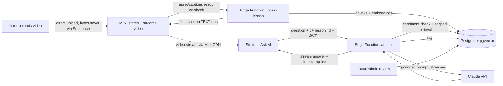

# PRP — Release 6 (Month 6): Recorded Lectures & AI Tutor

> **Status:** Draft, scoped (not yet elaborated to build level)
> **Architecture:** [arch.md](../../architecture/arch.md), plus the additions in §5 of this document
> **Depends on:** [Release 2](../release-2/PRP.md) (auth, roles), [Release 3](../release-3/PRP.md) (students, enrolments), [Release 4](../release-4/PRP.md) (communities/classes for access control). [Release 5](../release-5/PRP.md) is needed only for the mobile version.

---

## 1. Objective

Let students **ask questions while watching a recorded lecture** and get AI-generated answers **grounded in that specific video, lesson and the AJ Classes curriculum**, with links back to the exact moment in the video.

The release has two parts:

| Part | What | Why it's needed |
|---|---|---|
| **6A — Recorded Lecture Library** | Upload, organise and securely stream recorded lectures (course → subject → chapter → lesson → video) | Prerequisite: the AI tutor needs videos, transcripts and a lesson structure to work on. None of these exist in R1–R5 |
| **6B — AI Tutor on Recorded Videos** | "Ask AI" chat beside each video, answers grounded in the transcript and course materials | The main feature |

### 1.1 Success Metric

The feature should help students **understand the lecture without leaving the video**. Measured by:

| Signal | How it's measured |
|---|---|
| AI-question engagement | % of video views with ≥ 1 AI question; questions per active student per week |
| Lesson completion | Completion rate of lessons with AI Tutor vs. before it was available |
| Quiz / assignment performance | Scores on related R3 assignments for students who used the tutor vs. those who didn't (directional only) |
| Student feedback | 👍 / 👎 on each answer; target ≥ 80% 👍 |
| Answer quality (internal) | Teacher-reviewed sample: grounded, correct, age-appropriate; target ≥ 90% |

---

## 2. Part 6A — Recorded Lecture Library (prerequisite)

### 2.1 What Is Stored Where

**Video files never touch our database, storage or Edge Functions.** Mux stores, encodes and streams every video. Our database keeps only **references and text**, a few kilobytes per video.

| Stored in **Mux** | Stored in **Supabase** (Postgres) | Never stored by us |
|---|---|---|
| Original upload, encoded renditions, streaming (HLS/CDN), thumbnails, auto-generated caption track | Mux `asset_id` + `playback_id` (the "link"), title, duration, lesson it belongs to | Video bytes, video frames |
| | **Transcript text** with timestamps (a VTT file is typically ~50–150 KB for a 1-hour lecture) | |
| | Transcript chunks + embeddings for AI search (a few hundred KB per lecture) | |
| | AI conversations, watch progress | |

**Bandwidth path:**
- **Upload:** tutor's browser → **straight to Mux**, using a one-time Mux direct-upload URL that an Edge Function requests. Supabase only handles that small API call.
- **Playback:** student's device → **Mux CDN**. Supabase only issues the short-lived signed playback token (a tiny request).
- **AI Tutor:** works **only on transcript text** and course materials. It never reads or streams the video. "Jump to 12:43" just tells the Mux player to seek. Nothing is re-fetched through our backend.

So Supabase bandwidth and storage cost for videos stays close to zero, and Mux billing covers video storage and delivery.

### 2.2 Requirements

| ID | Requirement |
|---|---|
| 6A.1 | **Content hierarchy:** `course → subject → chapter → lesson → video`. A lesson can also have teacher notes and materials (PDF/DOCX/slides). |
| 6A.2 | **Upload:** tutors or admins upload lecture videos from the Tutor Dashboard **directly to Mux** (Mux direct-upload URL). The upload never goes through Supabase. Only the returned Mux IDs are saved. Videos are private by default (signed playback policy). **Alternative:** a tutor can upload in the Mux dashboard and paste the asset/playback ID into the lesson form. |
| 6A.3 | **Secure playback:** a Supabase Edge Function checks enrolment and issues a short-lived **signed Mux playback token**, as described in arch.md. No public video URLs. |
| 6A.4 | **Access control:** a student can see a lesson only if they're enrolled in the course or community it belongs to (RLS, same model as R3/R4). |
| 6A.5 | **Captions/transcript:** every video gets a timestamped transcript (see 6B pipeline), also shown as closed captions for accessibility. |
| 6A.6 | **Player:** Mux Player (web) with playback speed, captions, resume position, and a programmatic "seek to timestamp" API (needed for 6B). |
| 6A.7 | **Progress tracking:** watch progress per student per video (needed for the lesson completion metric). |

---

## 3. Part 6B — AI Tutor on Recorded Videos

### 3.1 Core Experience

1. Student watches a recorded lecture.
2. Student opens **"Ask AI"** beside the video (desktop) or below it (mobile).
3. Student asks a question, e.g. *"Why did the teacher move x to the other side?"*
4. The AI finds the relevant content in the current lecture. The current playback position is sent with the question, so "this part" or "just now" questions resolve correctly.
5. The AI replies with a **concise explanation** and, where possible, **references the relevant video timestamp**.
6. The student can ask follow-up questions in the same conversation.

**Example**

> **Student:** Why is 3x + 5 = 20 solved by subtracting 5 first?
>
> **AI Tutor:** Because we want to isolate x. Subtracting 5 from both sides gives 3x = 15, then dividing by 3 gives x = 5.
> **[▶ Jump to 12:43 in the lecture]**

### 3.2 AI Knowledge Sources (in priority order)

1. **Current video transcript** (highest priority, with the section around the current playback position weighted up)
2. **Teacher notes / materials** for the lesson
3. **Current lesson / chapter content**
4. **Course curriculum**
5. **Approved textbooks / resources** (only those the admin has uploaded and approved)

**Scope rule:** the AI answers **only within the course context**. For off-topic questions it politely redirects (e.g. *"I can help with questions about this lesson. For other questions, ask your tutor."*). A per-course admin setting, **"Allow general subject help"**, can relax this to general questions on the same subject. It is off by default.

### 3.3 Processing Pipeline

```text
Recorded Video (Mux)
      ↓
Transcription (Mux auto-generated captions, or a speech-to-text service)
      ↓
Timestamped Transcript  ──→ teacher review/correction (optional, recommended for maths notation)
      ↓
Chunking + Metadata   (≈ 30–90 s windows, split on sentence boundaries, small overlap)
      ↓
Embeddings / Search Index  (Supabase Postgres + pgvector, plus keyword search)
      ↓
AI Tutor (Supabase Edge Function)
      ↑
Student Question (+ current timestamp, lesson_id, conversation history)
      ↓
Relevant Content Retrieval  (filtered to this lesson/course by metadata + access check)
      ↓
LLM Response (streamed, with timestamp references)
```

Teacher notes, materials, curriculum docs and approved resources go through the same **chunk → embed → index** steps, with `source_type` metadata.

**Chunk metadata (required on every chunk):**

```text
course_id
subject_id
chapter_id
lesson_id
video_id            (null for non-video sources)
start_timestamp     (seconds; null for non-video sources)
end_timestamp
source_type         (transcript | teacher_notes | lesson_content | curriculum | resource)
source_ref          (e.g. file id + page, for non-video sources)
text
embedding
```

**Pipeline triggers:** a Mux `video.asset.ready` / captions-ready webhook starts the pipeline in an Edge Function. Re-indexing happens automatically when a transcript is corrected or materials change. The indexing status (Processing / Ready / Failed) shows in the Tutor Dashboard. The "Ask AI" button is enabled only when the index is **Ready**.

### 3.4 MVP Requirements

| ID | Requirement | Notes |
|---|---|---|
| 6B.1 | **AI chat attached to each recorded video** | A side panel on desktop and a bottom sheet on mobile. Responses stream in token by token |
| 6B.2 | **Timestamped video transcript** | Also shown as captions. Optional searchable transcript panel |
| 6B.3 | **RAG-based answers** | Retrieval scoped by `lesson_id` first, widening to chapter and course only if needed. Answers must be grounded in the retrieved content |
| 6B.4 | **Conversation history during the lesson** | Kept per student per video. The student can reopen it later. Past conversations aren't mixed into other lessons |
| 6B.5 | **"Jump to timestamp"** | The response includes structured timestamp references (e.g. `[[t=763]]`), rendered as buttons that seek the player. Timestamps are **validated server-side** against the retrieved chunks, so the AI can't invent a moment that doesn't exist |
| 6B.6 | **Course/lesson-level access control** | The Edge Function checks the student's JWT and enrolment **before** retrieval. The vector search runs under RLS or with explicit `course_id` filters, so content from other courses can never be retrieved |
| 6B.7 | **Basic moderation and prompt-injection protection** | See §3.5 |
| 6B.8 | **Teacher/admin review of AI conversations** | List conversations filtered by course, lesson, student, date and 👎 rating. Tutors can flag an answer as incorrect, and flagged answers feed into prompt and content fixes |
| 6B.9 | **Answer feedback** | 👍 / 👎 plus an optional comment on each answer |
| 6B.10 | **Usage limits** | Per-student daily question cap (configurable, e.g. 50/day) and a max question length, to control cost and abuse |

### 3.5 Safety, Moderation & Prompt-Injection Protection

| Area | Requirement |
|---|---|
| Instruction hierarchy | The system prompt defines the tutor's role, scope and style. The retrieved transcript, notes and student question are passed in as clearly delimited **data**. Instructions that appear inside them (e.g. "ignore previous instructions") are not followed |
| Grounding | If retrieval finds nothing relevant, the tutor says so and suggests asking the teacher, instead of guessing |
| Age-appropriate | Students are minors. Tone is encouraging and simple. No personal-data collection in chat. The model refuses unsafe or inappropriate topics |
| Wellbeing escalation | If a message suggests self-harm, bullying or a safety concern, the tutor shows a supportive message with Australian help resources (e.g. Kids Helpline) and **flags the conversation to an admin** |
| Academic integrity | When a question looks like a pasted assignment or test item, the tutor explains the method step by step instead of just giving the final answer (configurable per course) |
| Model refusals | The API may decline a request (`stop_reason: "refusal"`). The UI shows a friendly fallback message. Server-side fallbacks are enabled (see §5) |
| Logging | Every question, retrieved chunk IDs, answer, model and token usage is stored for review and quality evaluation. Retained per the privacy policy |
| Transparency | The chat panel clearly says the answers are AI-generated and may be wrong, and that teachers can see conversations. The privacy policy and parent communications are updated before launch |

### 3.6 Future Enhancements (post-MVP)

- **"Explain this part"** button: one tap asks about the current timestamp window
- Automatically generate questions from the lecture
- **AI-generated quizzes** per lesson (linked to R3 assignments and scores)
- **Student learning-gap detection**: patterns in questions and quiz results surfaced to tutors
- **Personalised explanations** based on student level
- **Voice-based AI tutor**
- AI tutor available **during and after live classes** (needs live transcription)
- AI tutor in the **Flutter mobile app** (R5 parity)

---

## 4. Data Model (sketch)

| Table | Key columns |
|---|---|
| `courses`, `subjects`, `chapters`, `lessons` | Hierarchy with FK links, `course_id` on every row for RLS |
| `lesson_videos` | **References only (no video data):** `lesson_id`, `mux_asset_id`, `mux_playback_id`, `title`, `duration`, `status`, `index_status` |
| `lesson_materials` | `lesson_id`, `storage_path`, `type`, `approved` |
| `transcripts` | `video_id`, segments JSON (`[{start, end, text}]`, fetched once from the Mux caption track), `source` (auto / corrected), `updated_by`. Text only |
| `content_chunks` | Metadata from §3.3 + `embedding vector(n)` + `tsvector` for keyword search |
| `ai_conversations` | `student_id`, `video_id`, `lesson_id`, `created_at`, `flagged` |
| `ai_messages` | `conversation_id`, `role`, `content`, `video_timestamp_at_ask`, `retrieved_chunk_ids[]`, `timestamp_refs[]`, `model`, `input_tokens`, `output_tokens`, `feedback`, `moderation_flags` |
| `video_progress` | `student_id`, `video_id`, `position`, `completed_at` |

RLS: students read and write only their own conversations and see only lessons they are enrolled in. Tutors can read conversations for the courses they teach. Admins can read all.

---

## 5. Architecture Additions

| Concern | Choice | Notes |
|---|---|---|
| Video hosting & playback | **Mux** (already in arch.md). **The only place video files live** | Direct upload to Mux; signed playback tokens via Edge Function; streaming from the Mux CDN |
| Transcription | **Mux auto-generated captions** (preferred, keeps the stack small) or a dedicated speech-to-text service | The indexer fetches the caption text track **once** after processing and saves the text. Check accuracy on maths content. Teacher correction UI for key lectures |
| Vector search | **Supabase Postgres + `pgvector`** | Hybrid search (vector + keyword) scoped by metadata filters. No extra vendor |
| Embeddings model | **To decide** (Anthropic doesn't offer an embeddings model; e.g. Voyage AI or another provider) | Choose on retrieval quality for short spoken-language chunks and cost |
| LLM | **Claude via the Anthropic API**, called from a Supabase Edge Function using the official TypeScript SDK (`@anthropic-ai/sdk`) | Default model **`claude-opus-5`**. Streaming responses. Adaptive thinking with **low/medium effort** for fast, concise chat answers (tune on an eval set). Server-side **refusal fallbacks** enabled. Model choice can be revisited on cost/quality after the eval (see Q3) |
| Prompt caching | Cache the stable prefix (system prompt + lesson-level context such as teacher notes and the lesson summary) | Many students ask about the same lesson, so the cached prefix is reused and cost and latency drop |
| Secrets | `ANTHROPIC_API_KEY` and the embeddings key only in Supabase Edge Function secrets | Never in client bundles |



---

## 6. Acceptance Criteria (MVP)

- [ ] No video bytes pass through Supabase. Supabase storage and egress don't grow noticeably as lectures are added; only transcript and index rows do.
- [ ] A tutor uploads a lecture. Within ~15 minutes of Mux processing, the transcript is available and the index status is **Ready**.
- [ ] A student enrolled in the course can open "Ask AI". A student not enrolled cannot play the video or query its content (tested directly against the API).
- [ ] For a test set of ≥ 30 real questions per pilot lesson, ≥ 90% of answers are rated **grounded and correct** by a teacher, and ≥ 80% include a valid timestamp that plays the relevant moment.
- [ ] Clicking a timestamp button seeks the player to within ±2 s of the referenced moment.
- [ ] Off-topic questions get the redirect response (scope rule, §3.2).
- [ ] Prompt-injection test set (e.g. "ignore your instructions and…", injected text in teacher notes) produces no out-of-scope or policy-breaking answers.
- [ ] Wellbeing-trigger test messages show help resources and create an admin flag.
- [ ] Tutors can view, filter and flag conversations for their courses. Students can't see other students' conversations.
- [ ] Daily question cap is enforced, with a friendly message.
- [ ] First token of the response appears within ~2–3 s at typical load.

---

## 7. Open Questions

| # | Question |
|---|---|
| Q1 | Pilot scope: which course(s) and lessons first? (Recommend one subject, e.g. Numerical Reasoning, 5–10 lessons) |
| Q2 | Is "Allow general subject help" ever wanted, or strictly lesson-only? |
| Q3 | Monthly AI budget per student. Confirm the default model (`claude-opus-5`) after the eval, or trial a lower-cost model if cost is a concern |
| Q4 | Embeddings provider choice |
| Q5 | Retention period for AI conversations, and whether parents can view their child's conversations |
| Q6 | Which approved textbooks or resources may be indexed (copyright and licensing check needed) |
| Q7 | Do teachers want to review and correct transcripts before AI is enabled on a lesson (quality gate), or auto-enable? |
